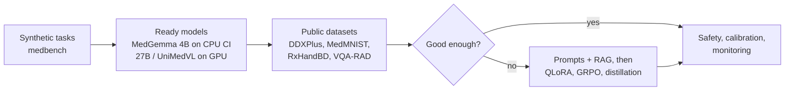

# Case study: issue #1, how to teach a neural network to process medical data

Issue: <https://github.com/konard/medical-neural-network-ml/issues/1>.
Pull request: <https://github.com/konard/medical-neural-network-ml/pull/2>.

The issue asks for a research plan and first tests. We try ready medical
models (MedGemma, UniMedVL and others) on synthetic versions of typical
medical tasks, measure their speed on CPU, provide GPU tests for a
self-hosted runner, calculate resources, and plan what to do if the ready
models are not good enough.

## Read in this order

| Page | What it answers |
| --- | --- |
| [requirements.md](requirements.md) | Every requirement of the issue and where it is solved |
| [research-plan.md](research-plan.md) | The plan, phase by phase, with alternatives |
| [measurements.md](measurements.md) | What was measured on the dev machine, and the calculated resources |
| [architectures.md](architectures.md) | How MedGemma, UniMedVL and the others work, and why it matters |
| [if-models-fail.md](if-models-fail.md) | Fine-tuning, training from scratch or from a base, and collecting and multiplying data |
| [ci-and-gpu-runner.md](ci-and-gpu-runner.md) | The CPU and GPU test jobs and how to set up a GPU runner |
| [glossary.md](glossary.md) | Plain explanations of all the terms |
| [research-notes/](research-notes/) | Long notes with sources: [models](research-notes/models.md), [datasets](research-notes/datasets.md), [hardware and CI](research-notes/hardware-and-ci.md), [training and data](research-notes/training-and-data.md) |
| [data/](data/) | Raw logs, benchmark tables, estimator output and the issue text |

## Main findings

1. **Testing works without real patient data.** `medbench` creates six
   synthetic tasks with exact answers and scores any model through one
   OpenAI-compatible API. 80 unit tests cover it, and they run in seconds.
2. **CPU is enough for a smoke test, not for research.** MedGemma 4B in
   4-bit writes **4.2 tokens/s** on 4 CPU threads when the weights are in
   RAM. When memory is tight and the weights are mapped from disk, it drops
   to **0.4 tokens/s**. A full test set (120 requests) would take about 6
   hours on a GitHub CPU runner, so CI runs 6 requests, and the full set
   runs on a GPU (about 8 minutes on an L4 for 4B, 51 minutes for 27B).
3. **MedGemma 27B needs a GPU**: 18.3 GB in 4-bit, 56 GB in bf16.
   **UniMedVL** has no llama.cpp build and needs PyTorch on a 40 GB+ GPU.
   Its extra 7B of weights is for drawing images, not for better answers.
4. **Most of the medical skill comes from data, not architecture.**
   MedGemma and Lingshu are ordinary Gemma 3 / Qwen2.5-VL models trained on
   medical data. So if ready models fail, fine-tuning on our own data
   (QLoRA: 4.9 GB of GPU memory for 4B, 19.6 GB for 27B) is the right next
   step. Training from scratch is not.
5. **Handwritten prescriptions are the riskiest task.** No public
   benchmark exists. The plan is OCR VLM → RxNorm fuzzy match → human
   check for every uncertain dose.
6. **Ultrasound is where general VLMs are weakest.** Use a task network
   there.



## The synthetic test inputs

Made by [`examples/medbench_quickstart.py`](../../../examples/medbench_quickstart.py).
The code knows the right answer for each one.

| Handwritten prescription | Printed medical history |
| --- | --- |
|  |  |

| Chest X-ray phantom | Brain MRI phantom | Ultrasound phantom |
| --- | --- | --- |
|  |  |  |

## How to reproduce

Everything below except steps 4–5 runs in seconds and downloads nothing.

```bash
# 1. Install
pip install -e ".[dev]"

# 2. Sample images, a baseline score and a resource estimate
python examples/medbench_quickstart.py /tmp/medbench-samples

# 3. Any task with any backend; naive-bayes and scripted need no model
medbench host
medbench run --task diagnosis --backend naive-bayes --count 50
medbench estimate --model medgemma-27b-it --hardware l4-24gb
medbench estimate --model unimedvl --hardware a100-80gb --quant bf16 --finetune

# 4. A real model on CPU: downloads MedGemma 4B (about 3.3 GB, pinned by
#    SHA-256) and llama.cpp; needs about 6 GB of free RAM to be fast
bash scripts/medbench-model-run.sh download
bash scripts/medbench-model-run.sh run

# 5. The same tests in CI: CPU smoke test on GitHub, all tests on a GPU runner
gh workflow run model-tests.yml -f gpu=true -f gpu-model=medgemma-27b-it -f count=20

# Unit tests (models not needed)
pytest
```

Commands for repeating the measurements are in
[measurements.md §8](measurements.md#8-how-to-repeat-these-measurements).
