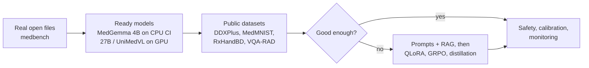

# Case study: issue #1, how to teach a neural network to process medical data

Issue: <https://github.com/konard/medical-neural-network-ml/issues/1>.
Pull request: <https://github.com/konard/medical-neural-network-ml/pull/2>.

The issue asks for a research plan and first tests. We try ready medical
models (MedGemma, UniMedVL and others) on typical medical tasks built
from real, openly licensed files, measure their speed on CPU, provide GPU
tests for a
self-hosted runner, calculate resources, and plan what to do if the ready
models are not good enough.

## Read in this order

| Page | What it answers |
| --- | --- |
| [requirements.md](requirements.md) | Every requirement of the issue and where it is solved |
| [research-plan.md](research-plan.md) | The plan, phase by phase, with alternatives |
| [measurements.md](measurements.md) | What was measured on the dev machine and a GitHub runner, and the calculated resources |
| [architectures.md](architectures.md) | How MedGemma, UniMedVL and the others work, and why it matters |
| [if-models-fail.md](if-models-fail.md) | Fine-tuning, training from scratch or from a base, and collecting and multiplying data |
| [ci-and-gpu-runner.md](ci-and-gpu-runner.md) | The CPU and GPU test jobs and how to set up a GPU runner |
| [data-sources.md](data-sources.md) | The real test files, their licenses and authors, and what was rejected |
| [glossary.md](glossary.md) | Plain explanations of all the terms |
| [research-notes/](research-notes/) | Long notes with sources: [models](research-notes/models.md), [datasets](research-notes/datasets.md), [hardware and CI](research-notes/hardware-and-ci.md), [training and data](research-notes/training-and-data.md) |
| [data/](data/) | Raw logs, benchmark tables, estimator output and the issue text |

## Main findings

1. **Testing works on real files without private patient data.**
   `medbench` scores any model through one OpenAI-compatible API on seven
   tasks. The inputs are 40 real, openly licensed files: chest X-rays,
   brain MRI and ultrasound images from Wikimedia Commons, prescription
   handwriting from RxHandBD, scanned case histories from Wikisource and
   DDXPlus patient interviews. They are downloaded at test time and checked
   by SHA-256; none is stored in the repository
   ([data-sources.md](data-sources.md)). Unit tests run in seconds without
   a download.
2. **CPU is enough for a smoke test, not for research.** On a GitHub-hosted
   runner ([run 38550186566](https://github.com/konard/medical-neural-network-ml/actions/runs/38550186566)),
   MedGemma 4B in 4-bit writes **7.8–11.6 tokens/s**, but reading one image
   takes **66–84 s**. A text question takes about 6 s and an image question
   70–90 s. Two hosted runners differed by up to 45%. On the 3 GiB dev VM it writes 4.2 tokens/s, and only **0.4 tokens/s**
   when the weights have to be mapped from disk. A full test set (up to 120
   requests) would take about 2–2.5 hours on a GitHub CPU runner, so CI runs 6
   requests (6–8 minutes), and the full set runs on a GPU (about 8 minutes on
   an L4 for 4B, 51 minutes for 27B).
3. **The first model scores are a warning, not a result.** On generated
   inputs (a toy diagnosis set, font-rendered prescriptions and drawn
   "phantom" X-rays) MedGemma 4B got **both drawn X-rays wrong**, and a
   second runner read one prescription differently, because a different
   CPU can change a greedy answer. On real files
   ([run 38714694090](https://github.com/konard/medical-neural-network-ml/actions/runs/38714694090))
   it found a left pneumothorax and its side, called a normal film normal,
   put the true DDXPlus condition first for 1 of 2 patients (second for the
   other), and read 1 of 2 handwritten drug names exactly ("depxe 60" for
   "Dexter 60"). Two items per task prove that the pipeline works, nothing
   more ([measurements.md §10](measurements.md#10-the-first-run-on-real-openly-licensed-files)).
4. **MedGemma 27B needs a GPU**: 18.3 GB in 4-bit, 56 GB in bf16.
   **UniMedVL** has no llama.cpp build; it runs through its own PyTorch
   code behind `scripts/unimedvl_server.py`, probably on a 40 GB+ GPU
   (an estimate; not measured yet).
   Its extra 7B of weights is for drawing images, not for better answers.
5. **Most of the medical skill comes from data, not architecture.**
   MedGemma and Lingshu are ordinary Gemma 3 / Qwen2.5-VL models trained on
   medical data. So if ready models fail, fine-tuning on our own data
   (QLoRA: 4.9 GB of GPU memory for 4B, 19.6 GB for 27B) is the right next
   step. Training from scratch is not.
6. **Handwritten prescriptions are the riskiest task.** No public
   benchmark exists. The plan is OCR VLM → RxNorm fuzzy match → human
   check for every uncertain dose.
7. **Ultrasound is where general VLMs are weakest.** Use a task network
   there.



## The real test inputs

Every image and page is a real file under an open license, downloaded when
the tests run. Some examples (click to open the file page with its author
and license):

| Task | Example file | Answer the model must give |
| --- | --- | --- |
| `imaging-xray` | [Spontanpneumothorax links 2010](https://commons.wikimedia.org/wiki/File:Spontanpneumothorax_links_2010.jpg), Hellerhoff, CC BY-SA 3.0 | pneumothorax, left side |
| `imaging-mri` | [Akustikus-Schwannom rechts](https://commons.wikimedia.org/wiki/File:Akustikus-Schwannon_rechts_MRT_T1KM_axial_001.jpg), Hellerhoff, CC BY-SA 3.0 | vestibular schwannoma, right side |
| `imaging-ultrasound` | [Ultrasonography of a normal liver](https://commons.wikimedia.org/wiki/File:Ultrasonography_of_a_normal_liver.jpg), Mikael Häggström, CC0 | normal |
| `ocr-prescription` | Word P3113 of [RxHandBD](https://data.mendeley.com/datasets/dsb5r6vskg/1), Md Masudul Islam, CC BY 4.0 | “Omeprazole” |
| `ocr-history` | [Report on the outbreak of plague at Fremantle, p. 13](https://en.wikisource.org/wiki/Page:Report_on_the_outbreak_of_plague_at_Fremantle.djvu/13), 1903, public domain | the proofread page text |
| `diagnosis-ddxplus` | [DDXPlus](https://figshare.com/articles/dataset/DDXPlus_Dataset_English_/22687585) test patients, CC BY 4.0 | the true condition in the top 5 |

All 40 files, their licenses and the rejected sources are in
[data-sources.md](data-sources.md). The images are linked, not copied here,
so this page does not have to carry their licenses.

## How to reproduce

Step 2 downloads the 40 real files (about 60 MB, mostly the RxHandBD
archive and the DDXPlus test split). Steps 4–5 download a model. The rest
runs in seconds.

```bash
# 1. Install
pip install -e ".[dev]"

# 2. Real files with ATTRIBUTION.md, a baseline score and a resource estimate
python examples/medbench_quickstart.py /tmp/medbench-samples
medbench sources            # every file with its license and author

# 3. Any task with any backend; naive-bayes and scripted need no model
medbench host
medbench run --task diagnosis --backend naive-bayes --count 50
medbench estimate --model medgemma-27b-it --hardware l4-24gb
medbench estimate --model unimedvl --hardware a100-80gb --quant bf16 --finetune

# 4. A real model on CPU: downloads MedGemma 4B (about 3.3 GB, pinned by
#    SHA-256) and llama.cpp; needs about 6 GB of free RAM to be fast
bash scripts/medbench-model-run.sh download
bash scripts/medbench-model-run.sh run

# 5. The same tests in CI: CPU smoke test on GitHub, all tests on a GPU runner
gh workflow run model-tests.yml -f gpu=true -f gpu-model=medgemma-27b-it -f count=20

# Unit tests (models not needed)
pytest
```

Commands for repeating the measurements are in
[measurements.md §8](measurements.md#8-how-to-repeat-these-measurements).
