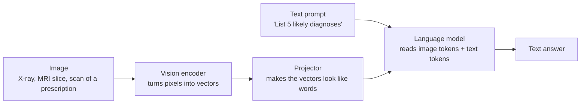
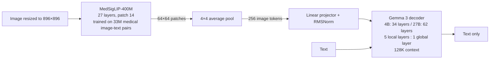
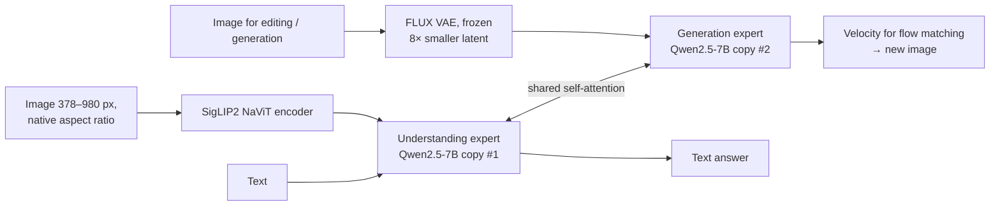
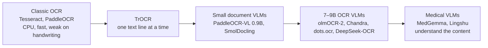
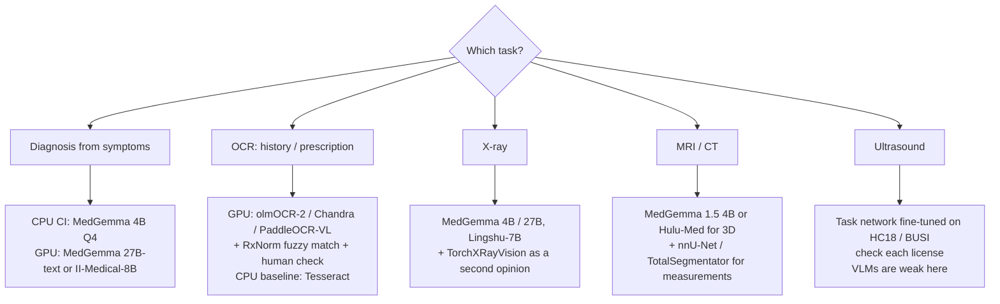

# How the best models are built, and why it matters

This page explains, in plain words, how today's strongest open medical
models work inside and how those design choices change the results on our
tasks. Facts and sources are in
[`research-notes/models.md`](research-notes/models.md). Words in *italics*
are explained in the [glossary](glossary.md).

## 1. One picture for all of them

Almost every model in this study is a *vision-language model* (VLM). It has
three parts:

1. **Vision encoder.** It cuts the picture into small squares (*patches*,
   usually 14×14 pixels) and turns each square into a vector.
2. **Projector.** A small network that maps these vectors into the "word
   space" of the language model, so an image becomes a few hundred extra
   "words" (*image tokens*).
3. **Language model (LLM).** A *transformer* that reads all tokens and
   writes the answer one token at a time.

The models differ in **what data** trained each part, **how many image
tokens** a picture becomes, whether they understand **3D volumes**, whether
they can also **draw images**, and **how big** the language model is.

## 2. MedGemma (Google): Gemma 3 plus a medical eye

* **Same body as Gemma 3, different schooling.** Google did not add new
  layers. They replaced the image encoder with MedSigLIP, which is SigLIP
  trained further on medical pairs. Then they continued pre-training on
  medical images and text, and finished with distillation and
  *reinforcement learning*. That alone lifted eye-photo grading (EyePACS)
  from 14.4 to 64.9 and MedQA from 50.7 to 64.4 for the 4B model.
* **Every image becomes exactly 256 tokens.** This is cheap and fast, and
  good for "is there pneumonia?" questions. Tiny details can be lost,
  though: a small nodule, or small handwriting on a scanned page.
* **5:1 local/global attention.** Five of every six layers only look at
  the last 1 024 tokens, and one layer looks at everything. This keeps the
  *KV cache* small, so a 128K-token context (a whole medical history) is
  affordable.
* **Sizes:** 4B (image + text), 27B (image + text) and 27B-text (text only,
  the best one for diagnosis from symptoms: MedQA 87.7). MedGemma 1.5 4B
  adds 3D CT/MRI and whole-slide pathology and beats the old 27B on MRI
  (64.7 vs 57.4).
* **License:** Health AI Developer Foundations terms. You must accept them
  on Hugging Face before downloading.

## 3. UniMedVL (Shanghai AI Lab): one model that reads and draws

* **Mixture-of-Transformers (MoT).** UniMedVL is a medical fine-tune of
  ByteDance BAGEL. There are two full copies of a 7B language model: one for
  text and image *understanding*, one for image *generation*. A token goes
  to a copy by its type (no learned router). All tokens share one attention
  step, so the two halves can see each other. 14B weights in total, 7B used
  per token.
* **Native resolution.** The NaViT encoder keeps the original aspect ratio
  and up to 70×70 patches, so a large image becomes many tokens. This helps
  with fine detail and costs memory.
* **It can draw.** It generates and edits images (for example, MRI to CT
  translation or super-resolution) with *flow matching* in the latent space
  of a frozen FLUX VAE. Training mixes the text loss and the image loss
  (cross-entropy + 0.25 × MSE).
* **Training:** a 3-stage curriculum (85K, 120K and 70K steps) on 8×A800
  GPUs with UniMed-5M (5.6M samples, 8–9 image types).
* **Results:** SLAKE 75.4, OmniMedVQA 85.8, VQA-RAD 61.9. That is close to
  7–8B "understanding-only" models, so the extra 7B of weights buys image
  generation, not better answers.
* **Practical:** Apache-2.0, not gated. But the checkpoint is 29 GB in bf16
  and there is no GGUF or llama.cpp support, so it needs a 40 GB+ GPU (or
  two 24 GB GPUs) and PyTorch. It cannot run on our CPU CI.

## 4. Other strong options

| Model | How it is built | What it is good at | Why it differs |
| --- | --- | --- | --- |
| **Lingshu 7B / 32B** (MIT) | Unchanged Qwen2.5-VL, trained on curated medical data with multi-stage fine-tuning and RL | Best average on the shared 7-benchmark suite: 61.8 (7B), 66.6 (32B) | Native-resolution encoder, permissive license |
| **Hulu-Med 7B / 32B** (Apache-2.0) | Qwen2.5 + ViT with about 55% image-token reduction | 2D, 3D volumes and video in one model; SLAKE 86.8, VQA-RAD 78.0 (7B) | Handles CT/MRI as volumes, not single slices |
| **HuatuoGPT-Vision 7B / 34B** | CLIP-L + MLP + Qwen2 | 54.2 average | Older, lower-resolution encoder |
| **MedVLM-R1 2B** | Qwen2-VL-2B + GRPO on 600 samples | Out-of-distribution VQA 55% → 78% | Shows how much a little RL can help |
| **CheXagent, MAIRA-2** | Chest-X-ray-only encoders + LLM | Chest X-ray reports; MAIRA-2 marks *where* the finding is | Specialists, narrow input |
| **LLaVA-Med 7B** (research only) | CLIP-L + Mistral | 37.8 average | Shows that old generic encoders fall behind |

**Text-only models for diagnosis from symptoms:** MedGemma 27B-text (MedQA
87.7), II-Medical-8B (MedQA 87.8, self-reported), HuatuoGPT-o1-72B (MedQA
88.9), m1-7B (MedQA 75.8) and Baichuan-M2-32B (HealthBench 60.1). The best of them are
*reasoning models* trained with reinforcement learning.

**OCR for histories and prescriptions.** There are five families, from
cheap to strong:

On olmOCR-bench, Chandra scores 83.1, olmOCR-2 82.3, Marker 76.5,
DeepSeek-OCR 75.4 and GPT-4o 69.9. **No public benchmark for handwritten
prescriptions exists.** The safe pattern is: VLM reads the page → match each
drug name against RxNorm with fuzzy matching → a human checks anything
uncertain.

**Imaging tools that are not LLMs.** For measuring and segmenting, task
networks are still better than chat models: TorchXRayVision (chest X-ray
classifiers), MONAI, nnU-Net and TotalSegmentator (CT/MRI segmentation),
and MedSAM / MedSAM2 / SAM-Med3D (click-to-segment). Generalist VLMs are
weakest on **ultrasound**, so a task network is the default there.

## 5. How these differences change our results

| Design choice | Models | Effect on our tasks |
| --- | --- | --- |
| Medical data on an unchanged base | MedGemma, Lingshu | Most of the medical gain comes from data, not architecture. **We can get gains the same way by fine-tuning on our data.** |
| Fixed 256 image tokens at 896² | MedGemma | Fast and cheap. May miss small findings and small handwriting. Crop or tile large scans before sending them. |
| Native resolution (NaViT, Qwen-VL) | UniMedVL, Lingshu, Hulu-Med, OCR VLMs | Better OCR and localization. Memory grows with image size, so cap the pixel count. |
| 3D volumes | MedGemma 1.5, Hulu-Med, SAM-Med3D | Needed for MRI/CT series. A 3D-aware 4B model can beat a 2D-only 27B model. |
| Image generation (MoT) | UniMedVL | Double the weights. Useful for **making synthetic training data**, not for answering. |
| Long context (5:1 attention) | Gemma 3 / MedGemma | A whole patient history fits in one prompt. |
| Reasoning + RL | MedGemma post-training, HuatuoGPT-o1, MedVLM-R1, Baichuan-M2 | Better differential diagnosis. Accuracy stops improving after about 4K thinking tokens (m1), so add retrieval of guidelines. |
| Instruction tuning | MedGemma -it vs -pt | Changes the *style* of reports (RadGraph F1 21.9 vs 29.5). Pick the variant that matches the output format you need. |
| Different metrics per model card | all | Scores from different cards cannot be compared. **Run every model on the same harness** (our `medbench`, then MedEvalKit or VLMEvalKit). |

## 6. Which model for which task (starting point)

The real-model tests in this repository start with **MedGemma 4B** (fits
in CPU CI) and **MedGemma 27B** (GPU runner), because the issue names
MedGemma, and llama.cpp can run both from the same script. UniMedVL is
measured on paper only. Running it needs the PyTorch backend
(`TransformersBackend` in `src/medbench/backends.py`) on a 40 GB+ GPU. That
is listed as the next step in [research-plan.md](research-plan.md).
