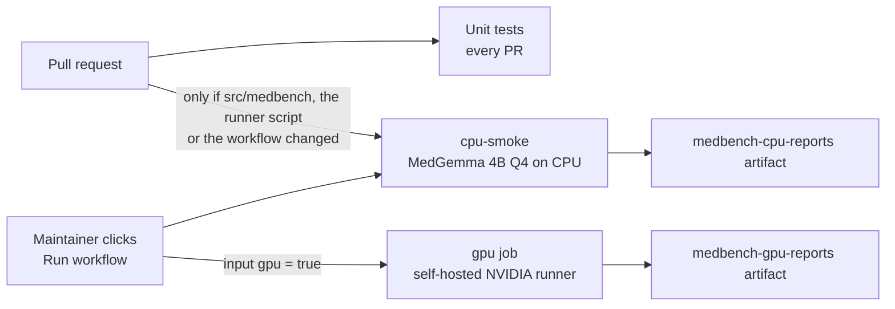
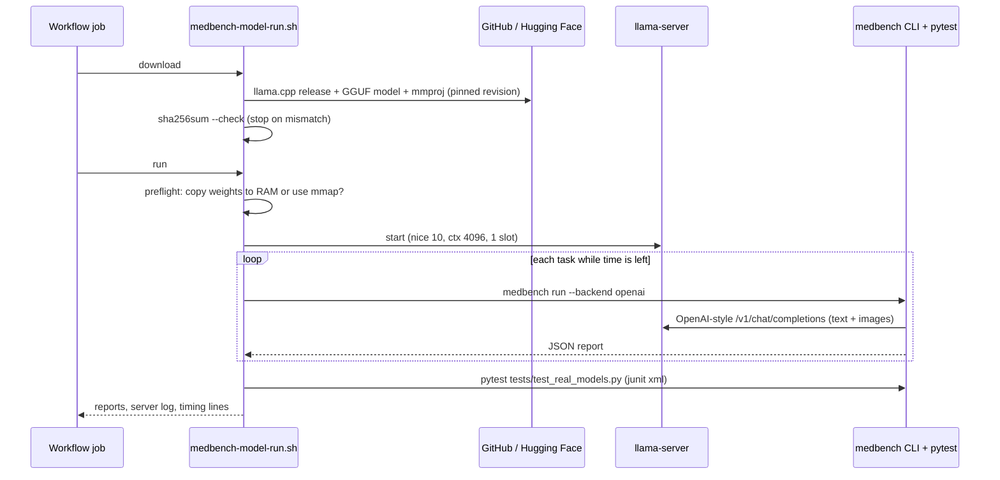
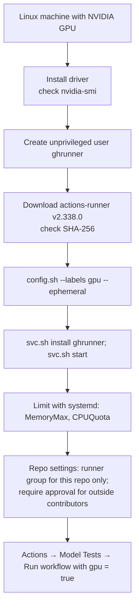

# CI/CD for real models: CPU smoke tests and a self-hosted GPU runner

This page explains how the real-model tests run in GitHub Actions, why the
CPU job is only a smoke test, and how to connect a machine with an NVIDIA GPU
as a self-hosted runner for the full tests. Sources and the raw notes are in
[research-notes/hardware-and-ci.md](research-notes/hardware-and-ci.md).

## 1. Two kinds of tests

There are three layers of tests. Only the last two need a real model.

| Layer | Where it runs | What it proves | Time |
|---|---|---|---|
| Unit tests (`pytest`) | Every pull request, hosted runner | Synthetic data, metrics, prompt parsing, resource maths, scripts | About 1 minute |
| CPU smoke test (`Model Tests / cpu-smoke`) | Hosted `ubuntu-24.04` runner (4 vCPU, 16 GB) | Download, hash check, serving, image input and scoring work end to end with MedGemma 4B | 10 to 25 minutes |
| GPU tests (`Model Tests / gpu`) | Self-hosted runner with labels `self-hosted, linux, x64, gpu` | All 6 tasks with more items; MedGemma 27B or 4B | 10 to 40 minutes |



Why the CPU job is only a smoke test: on a hosted runner MedGemma 4B Q4_K_M
reads text at about **25–33 tokens/s and writes the answer at 7.8–11.6
tokens/s** with 3 threads, but it needs **66–84 s to read one image**
([measurements.md §9](measurements.md#9-a-real-run-on-a-github-hosted-cpu-runner)).
So a text question takes about 6 s and an image question 70–90 s.
Twenty items per task over six tasks would take about 2–2.5 hours, so the hosted
CPU job runs 2 items per task over 3 tasks (6–8 minutes). It checks that
everything works; it does not measure accuracy. The 27B model does not fit on
a hosted runner at all (about 18 GB needed, 16 GB RAM in total).

## 2. What the workflow does

File: [`.github/workflows/model-tests.yml`](../../../.github/workflows/model-tests.yml).
Both jobs call the same script,
[`scripts/medbench-model-run.sh`](../../../scripts/medbench-model-run.sh):



Safety rules built into the job:

- **Every download is pinned.** The llama.cpp archive, the CUDA runtime, the
  model and the vision projector each have a SHA-256 in the script or the
  workflow. The model also has a fixed Hugging Face commit. A changed file
  fails the job instead of running.
- **No secrets.** The models come from the ungated `unsloth/*-GGUF` mirrors,
  so no Hugging Face token is needed. A test checks that `secrets.` never
  appears in the workflow.
- **Time budgets.** Each step runs under `scripts/run-with-budget-warning.sh`
  and stops before `timeout-minutes`, so a slow model gives a named failure,
  not a grey "cancelled" run. The script also has its own `TIME_BUDGET`: when
  it runs out, the remaining tasks are skipped.
- **Memory preflight.** The script compares the real model file size
  (following symlinks) with free memory, including the cgroup limit. If the
  weights plus 1 GiB fit, it copies them into RAM (`--load-mode none`), which
  gave 10 times faster decoding than mmap on our VM. If not, it uses mmap and
  turns off weight repacking (`--no-repack`), because repacking makes a
  private 1.4 GiB copy that got the server killed under a 3 GiB limit.
- **Low priority.** The server runs under `nice -n 10`, so a developer machine
  stays responsive.

## 3. Running it

| How | Command or action |
|---|---|
| On a pull request | Automatic for changes under `src/medbench/**`, the runner script, `tests/test_real_models.py` or the workflow |
| By hand, CPU only | Actions → Model Tests → Run workflow (leave `gpu` off) |
| By hand, with GPU | Actions → Model Tests → Run workflow, tick `gpu`, choose `medgemma-27b-it` or `medgemma-4b-it` |
| From the terminal | `gh workflow run model-tests.yml -f gpu=true -f gpu-model=medgemma-27b-it -f count=20` |
| On your own machine | `bash scripts/medbench-model-run.sh download && bash scripts/medbench-model-run.sh run` |

Useful environment variables for local runs: `THREADS`, `COUNT`, `TASKS`,
`MAX_TOKENS`, `TIME_BUDGET`, `GPU_LAYERS`, `LOAD_MODE`, `NICE_LEVEL`. See the
header of the script for the full list.

## 4. Choosing GPU hardware

The numbers below come from `medbench estimate` (this repository's resource
calculator; decode speed is about memory bandwidth divided by model size, with
an efficiency factor). They are estimates, not measurements.

| GPU (VRAM) | MedGemma 4B Q4 | MedGemma 27B Q4_K_M (about 18 GB) | MedGemma 27B bf16 (about 56 GB) | UniMedVL bf16 (about 30 to 40 GB) | Rent price per hour (2026) |
|---|---|---|---|---|---|
| T4 (16 GB) | Yes, about 69 tok/s | No (only 3-bit quants) | No | No | $0.15 to $0.55; GitHub hosted T4 $3.12 |
| L4 (24 GB) | Yes, about 65 tok/s | Yes, about 10 tok/s | No | No | $0.3 to $0.8 |
| RTX 4090 (24 GB) | Yes, about 218 tok/s | Yes, about 35 tok/s | No | No | $0.35 to $0.9 |
| A100 (80 GB) | Yes | Yes, about 71 tok/s | Yes, about 22 tok/s | Yes | $1.2 to $2.8 |
| H100 (80 GB) | Yes | Yes, about 116 tok/s | Yes | Yes | $2 to $4 (AWS about $6.9) |

Alternatives for where to run the GPU tests:

| Option | Pros | Cons |
|---|---|---|
| **Self-hosted runner on your own GPU box** (chosen) | No per-minute cost; any GPU; model cache stays on disk | You maintain it; risky with public repositories unless locked down (section 6) |
| GitHub-hosted GPU runner (T4) | No machine to maintain; clean VM each time | Team/Enterprise plans only; $0.052/min; 16 GB is too small for 27B Q4 |
| Rented cloud GPU started per run (RunPod, Lambda, Vast.ai) with an ephemeral runner | Pay only while tests run; choose an 80 GB GPU when needed | Needs a cloud API key as a secret and start/stop automation |
| No GPU in CI; run on demand and commit reports | Simplest and safest | Results can go stale; nothing blocks a regression |

## 5. Setting up the self-hosted GPU runner



1. **Driver.** Install the NVIDIA driver from your distribution (on Ubuntu,
   `sudo ubuntu-drivers install`) and check that `nvidia-smi` lists the GPU.
   The llama.cpp CUDA 12.8 build used by the workflow brings its own CUDA
   runtime (`cudart-*.tar.gz`), so the full CUDA toolkit is not required. A
   recent driver (R570 or newer, which supports CUDA 12.8) is needed.
2. **User.** Create a dedicated user, for example `sudo useradd -m ghrunner`.
   Never run the runner as root or as your own desktop user.
3. **Runner.** As `ghrunner`:

   ```bash
   mkdir -p ~/actions-runner && cd ~/actions-runner
   curl -o actions-runner-linux-x64-2.338.0.tar.gz -L \
     https://github.com/actions/runner/releases/download/v2.338.0/actions-runner-linux-x64-2.338.0.tar.gz
   # compare with the SHA-256 shown on Settings → Actions → Runners → New self-hosted runner
   sha256sum actions-runner-linux-x64-2.338.0.tar.gz
   tar xzf actions-runner-linux-x64-2.338.0.tar.gz
   ./config.sh --url https://github.com/konard/medical-neural-network-ml \
     --token <TOKEN-FROM-SETTINGS-PAGE> --labels gpu --name gpu-box-1 \
     --ephemeral --unattended
   ```

   The default labels `self-hosted`, `linux` and `x64` are added
   automatically; `gpu` is our own label (declared for actionlint in
   [`.github/actionlint.yaml`](../../../.github/actionlint.yaml)).
   `--ephemeral` makes the runner take one job and then unregister, so state
   from one job cannot leak into the next. Re-register it after each job (a
   small systemd timer or the just-in-time runner API can do this).
4. **Service.** `sudo ./svc.sh install ghrunner && sudo ./svc.sh start`.
5. **Limits.** Keep CI from taking over the machine:
   `sudo systemctl edit actions.runner.*` and add

   ```ini
   [Service]
   MemoryMax=48G
   CPUQuota=800%
   Nice=10
   ```

6. **Disk.** The 27B Q4_K_M model is 16.5 GB and its projector 0.8 GB. The
   workflow keeps them in `.cache/medbench` inside the work folder; give the
   runner at least 40 GB free.
7. **Optional: Docker.** Install `nvidia-container-toolkit`, run
   `sudo nvidia-ctk runtime configure --runtime=docker`, and test with
   `docker run --rm --gpus all ubuntu nvidia-smi`. The current workflow does
   not need Docker; it is useful if you later move to vLLM images.

## 6. Security for a public repository

GitHub's own guidance says self-hosted runners "should almost never be used
for public repositories", because anyone can open a pull request and run code
on the machine. This repository is public, so the workflow and the machine are
locked down:

| Risk | Protection used here |
|---|---|
| A fork's pull request runs code on the GPU box | The `gpu` job has `if: github.event_name == 'workflow_dispatch' && inputs.gpu`. Only people with write access can start it. A test (`tests/test_medbench_model_run.py`) keeps this condition in place. |
| A job steals tokens or secrets | `permissions: contents: read`, `persist-credentials: false`, and no `secrets.` in the workflow (also tested). |
| One job leaves malware for the next | `--ephemeral` runner; dedicated unprivileged user; optionally a fresh VM or container per job. |
| A changed model or binary is run | SHA-256 pinning of every download and a fixed model revision. |
| Other repositories use the runner | Put it in a runner group limited to this repository. |
| `pull_request_target` mistakes | Not used. Do not add it to this workflow. |

## 7. Development machine limits

The issue asks not to overload the development machine. Tools used in this
work, from lightest to strongest:

| Tool | Example | Notes |
|---|---|---|
| Fewer threads | `THREADS=4` (script), `-t 4` (llama.cpp), `OMP_NUM_THREADS=4` | Decode speed stops improving after the number of physical cores |
| Low priority | `nice -n 19`, `ionice -c3` | Other work stays responsive |
| Small runs | `COUNT=2 MAX_TOKENS=64 TIME_BUDGET=900` | The script stops cleanly when time is up |
| Hard caps | `systemd-run --user --scope -p MemoryMax=8G -p CPUQuota=400% ...` | The kernel kills only the capped scope |
| Containers | `docker run --cpus=4 --memory=8g --memory-swap=8g ...` | Same idea, with isolation |

On the development VM used for this study (6 vCPU, a 2.9 GiB cgroup memory
limit, no GPU) only MedGemma 4B at 4 bits can run, and only in mmap mode. See
[measurements.md](measurements.md) for what that costs.
