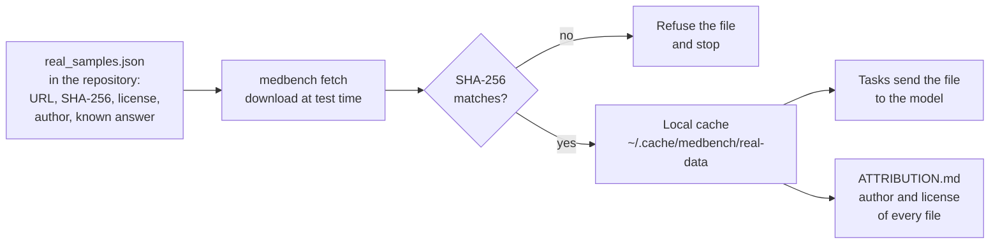

# Real test data: sources, licenses and attribution

The pull request review asked for realistic tests: real files that are in
the public domain or under a license that allows copying, with the license
noted where it asks for attribution, and **no made-up media** (no
handwriting drawn with fonts, no cartoon scans). This page lists the files
the tests use now, why they are legal to use, and what was rejected.

## How the files are used



* **No file is stored in the repository.** Only the manifest
  [`src/medbench/data/real_samples.json`](../../../src/medbench/data/real_samples.json)
  is. It says where each file lives, its SHA-256, its license, its author
  and the answer the model should give.
* **The download is checked.** If the bytes differ from the pinned hash, the
  file is refused, so a changed or swapped file can never change a score
  without a human checking it again.
* **Only open licenses are allowed:** public domain, CC0, CC BY and CC BY-SA.
  Non-commercial (NC) and no-derivatives (ND) licenses are refused by a
  test. The models only read the files; we do not publish changed copies.
* **Attribution is printed.** `medbench sources` lists every file with its
  author and license, and `medbench fetch` writes `ATTRIBUTION.md` next to
  the downloads. The CI job `Model Tests / Real sample files` uploads that
  file as an artifact.
* **Wikimedia is asked politely.** Requests go one at a time with a pause,
  name the project in the User-Agent, and wait as long as a
  `429 Too Many Requests` reply asks
  ([Wikimedia robot policy](https://wikitech.wikimedia.org/wiki/Robot_policy)).
  Pull requests reuse the CI cache; a weekly run downloads everything fresh
  to catch moved or changed files.

```bash
medbench sources                      # every file, license and author
medbench fetch --out /tmp/real-data   # download, check, write ATTRIBUTION.md
MEDBENCH_NETWORK_TESTS=1 pytest -m network tests/test_medbench_real_data.py
```

## What each task uses

| Task | Source | Files | License | Why this source |
| --- | --- | --- | --- | --- |
| `diagnosis-ddxplus` | [DDXPlus](https://figshare.com/articles/dataset/DDXPlus_Dataset_English_/22687585) (Fansi Tchango et al., NeurIPS 2022) | 3 (test patients, questions, conditions) | CC BY 4.0 | Realistic medical interviews with a true condition **and** a ranked differential, 49 conditions. The patients come from a clinician-built expert system, so there is no private data |
| `ocr-prescription` | [RxHandBD](https://data.mendeley.com/datasets/dsb5r6vskg/1) (Md Masudul Islam, doi:10.17632/dsb5r6vskg.1) | 6 word images cut from real handwritten prescriptions | CC BY 4.0 | The only openly licensed set of real prescription handwriting with checked transcriptions |
| `ocr-history` | Scanned pages on [Wikisource](https://en.wikisource.org/) | 5 pages of 1868–1907 case reports | Public domain | Real printed case histories with a proofread ("validated") transcription |
| `imaging-xray` | Wikimedia Commons | 9 chest X-rays (6 abnormal, 3 normal) | CC0, CC BY, CC BY-SA | Real radiographs, mostly uploaded by physicians, with the finding and side in the description |
| `imaging-mri` | Wikimedia Commons | 7 brain MRI slices (4 abnormal, 3 normal) | CC BY, CC BY-SA | same |
| `imaging-ultrasound` | Wikimedia Commons | 10 ultrasound images (7 abnormal, 3 normal) | CC0, CC BY, CC BY-SA | same |
| `diagnosis` | Generated by `synthetic_cases.py` | 0 (text only) | — | A toy text task with exact probabilities. It is kept as a check that the answer parser and top-k scoring work; it has no images |

Licenses across all 40 files: CC BY 4.0 (12), CC BY-SA 4.0 (9),
CC BY-SA 3.0 (6), CC0 1.0 (5), public domain (5), CC BY 3.0 (2),
CC BY 2.5 (1).

## Every file

The answer column is what the scorer checks. For images, "normal" means the
author describes the image as normal; for side, "none" on an abnormal image
means the description does not say a side, so that image is left out of the
side accuracy.

| Sample | Task | Answer the model must give | Author | License |
| --- | --- | --- | --- | --- |
| [ddxplus-test-patients](https://figshare.com/articles/dataset/DDXPlus_Dataset_English_/22687585) | `diagnosis-ddxplus` | patients file | Fansi Tchango et al. | [CC BY 4.0](https://creativecommons.org/licenses/by/4.0/) |
| [ddxplus-evidences](https://figshare.com/articles/dataset/DDXPlus_Dataset_English_/22687585) | `diagnosis-ddxplus` | evidences file | Fansi Tchango et al. | [CC BY 4.0](https://creativecommons.org/licenses/by/4.0/) |
| [ddxplus-conditions](https://figshare.com/articles/dataset/DDXPlus_Dataset_English_/22687585) | `diagnosis-ddxplus` | conditions file | Fansi Tchango et al. | [CC BY 4.0](https://creativecommons.org/licenses/by/4.0/) |
| [xray-pneumothorax-1](https://commons.wikimedia.org/wiki/File:Spontanpneumothorax_links_2010.jpg) | `imaging-xray` | pneumothorax, left side | Hellerhoff | [CC BY-SA 3.0](https://creativecommons.org/licenses/by-sa/3.0) |
| [xray-normal-1](https://commons.wikimedia.org/wiki/File:Normal_posteroanterior_(PA)_chest_radiograph_(X-ray).jpg) | `imaging-xray` | normal | Mikael Häggström | [CC0 1.0](https://creativecommons.org/publicdomain/zero/1.0/deed.en) |
| [xray-pneumothorax-2](https://commons.wikimedia.org/wiki/File:Spontanpneumothorax_rechts_2012.jpg) | `imaging-xray` | pneumothorax, right side | Hellerhoff | [CC BY-SA 3.0](https://creativecommons.org/licenses/by-sa/3.0) |
| [xray-normal-2](https://commons.wikimedia.org/wiki/File:Chest_X-ray_2346.jpg) | `imaging-xray` | normal | Doctoroftcm | [CC0 1.0](https://creativecommons.org/publicdomain/zero/1.0/deed.en) |
| [xray-pleural-effusion-1](https://commons.wikimedia.org/wiki/File:Effusion.png) | `imaging-xray` | pleural effusion, right side | James Heilman, MD | [CC BY-SA 3.0](https://creativecommons.org/licenses/by-sa/3.0) |
| [xray-normal-3](https://commons.wikimedia.org/wiki/File:Normal_AP.JPG) | `imaging-xray` | normal | James Heilman, MD | [CC BY 3.0](https://creativecommons.org/licenses/by/3.0) |
| [xray-pleural-effusion-2](https://commons.wikimedia.org/wiki/File:Mediastinalshift_nach_rechts_bei_grossem_Pleuraerguss_links_77W_-_CR_ap_-_001.jpg) | `imaging-xray` | pleural effusion, left side | Hellerhoff | [CC BY-SA 4.0](https://creativecommons.org/licenses/by-sa/4.0) |
| [xray-lobar-pneumonia-1](https://commons.wikimedia.org/wiki/File:X-ray_of_lobar_pneumonia.jpg) | `imaging-xray` | lobar pneumonia, right side | Mikael Häggström, M.D. | [CC0 1.0](https://creativecommons.org/publicdomain/zero/1.0/deed.en) |
| [xray-lung-mass-1](https://commons.wikimedia.org/wiki/File:Adenokarzinom_der_Lunge_im_Roentgenbild_63M_-_CR_pa_-_001.jpg) | `imaging-xray` | lung mass, right side | Hellerhoff | [CC BY-SA 4.0](https://creativecommons.org/licenses/by-sa/4.0) |
| [mri-vestibular-schwannoma-1](https://commons.wikimedia.org/wiki/File:Akustikus-Schwannon_rechts_MRT_T1KM_axial_001.jpg) | `imaging-mri` | vestibular schwannoma, right side | Hellerhoff | [CC BY-SA 3.0](https://creativecommons.org/licenses/by-sa/3.0) |
| [mri-normal-1](https://commons.wikimedia.org/wiki/File:Brain-T2-axial.png) | `imaging-mri` | normal | Sean Novak | [CC BY-SA 4.0](https://creativecommons.org/licenses/by-sa/4.0) |
| [mri-hemorrhagic-metastasis-1](https://commons.wikimedia.org/wiki/File:Melanoma_met_ax_t2.jpg) | `imaging-mri` | hemorrhagic metastasis, left side | Dr Laughlin Dawes | [CC BY 3.0](https://creativecommons.org/licenses/by/3.0) |
| [mri-normal-2](https://commons.wikimedia.org/wiki/File:Normal_axial_T2-weighted_MR_image_of_the_brain.jpg) | `imaging-mri` | normal | Novaksean | [CC BY-SA 4.0](https://creativecommons.org/licenses/by-sa/4.0) |
| [mri-cerebral-infarct-1](https://commons.wikimedia.org/wiki/File:DWI_MRI_of_a_cerebral_infarction.jpg) | `imaging-mri` | cerebral infarct, right side | Hellerhoff, isolation of DWI image by Mikael Häggström | [CC BY-SA 3.0](https://creativecommons.org/licenses/by-sa/3.0) |
| [mri-normal-3](https://commons.wikimedia.org/wiki/File:MRI_Head_Brain_Normal.jpg) | `imaging-mri` | normal | Ptrump16 | [CC BY-SA 4.0](https://creativecommons.org/licenses/by-sa/4.0) |
| [mri-hemorrhagic-contusion-1](https://commons.wikimedia.org/wiki/File:Frontale_Kontusionsblutung_MRT_HAEM_01.png) | `imaging-mri` | hemorrhagic contusion, right side | Hellerhoff | [CC BY-SA 3.0](https://creativecommons.org/licenses/by-sa/3.0) |
| [us-gallstones-1](https://commons.wikimedia.org/wiki/File:Schallschatten_bei_Cholecystolithiasis_71W_-_US_-_001.jpg) | `imaging-ultrasound` | gallstones | Hellerhoff | [CC BY-SA 4.0](https://creativecommons.org/licenses/by-sa/4.0) |
| [us-normal-1](https://commons.wikimedia.org/wiki/File:Right_kidney_seen_on_abdominal_ultrasound.jpg) | `imaging-ultrasound` | normal | Ptrump16 | [CC BY-SA 4.0](https://creativecommons.org/licenses/by-sa/4.0) |
| [us-gallstones-2](https://commons.wikimedia.org/wiki/File:Ultrasonography_of_sludge_and_gallstones.jpg) | `imaging-ultrasound` | gallstones | Mikael Häggström, M.D. | [CC0 1.0](https://creativecommons.org/publicdomain/zero/1.0/deed.en) |
| [us-normal-2](https://commons.wikimedia.org/wiki/File:Gallbladder_and_common_bile_duct_ultrasound.jpg) | `imaging-ultrasound` | normal | Ptrump16 | [CC BY-SA 4.0](https://creativecommons.org/licenses/by-sa/4.0) |
| [us-hydronephrosis-1](https://commons.wikimedia.org/wiki/File:Hydro.jpg) | `imaging-ultrasound` | hydronephrosis, left side | morning2k | [CC BY 2.5](https://creativecommons.org/licenses/by/2.5) |
| [us-normal-3](https://commons.wikimedia.org/wiki/File:Ultrasonography_of_a_normal_liver.jpg) | `imaging-ultrasound` | normal | Mikael Häggström | [CC0 1.0](https://creativecommons.org/publicdomain/zero/1.0/deed.en) |
| [us-hydronephrosis-2](https://commons.wikimedia.org/wiki/File:Ultrasonography_of_hydronephrosis_due_to_ureteropelvic_junction_obstruction.jpg) | `imaging-ultrasound` | hydronephrosis | Kristoffer Lindskov Hansen, Michael Bachmann Nielsen and Caroline Ewertsen | [CC BY 4.0](https://creativecommons.org/licenses/by/4.0) |
| [us-kidney-stone-1](https://commons.wikimedia.org/wiki/File:Ultrasonography_of_renal_stone_located_at_the_pyeloureteric_junction.jpg) | `imaging-ultrasound` | kidney stone | Kristoffer Lindskov Hansen, Michael Bachmann Nielsen and Caroline Ewertsen | [CC BY 4.0](https://creativecommons.org/licenses/by/4.0) |
| [us-kidney-stone-2](https://commons.wikimedia.org/wiki/File:Ultrasonography_of_staghorn_calculi_filling_the_entire_collecting_system.jpg) | `imaging-ultrasound` | kidney stone | Kristoffer Lindskov Hansen, Michael Bachmann Nielsen and Caroline Ewertsen | [CC BY 4.0](https://creativecommons.org/licenses/by/4.0) |
| [us-ovarian-cyst-1](https://commons.wikimedia.org/wiki/File:LargeLeftOvCyst5cm.png) | `imaging-ultrasound` | ovarian cyst, left side | James Heilman, MD | [CC BY-SA 4.0](https://creativecommons.org/licenses/by-sa/4.0) |
| [rx-word-p0007](https://data.mendeley.com/datasets/dsb5r6vskg/1) | `ocr-prescription` | “Napa” | Md Masudul Islam | [CC BY 4.0](https://creativecommons.org/licenses/by/4.0/) |
| [rx-word-p1126](https://data.mendeley.com/datasets/dsb5r6vskg/1) | `ocr-prescription` | “Dexter 60” | Md Masudul Islam | [CC BY 4.0](https://creativecommons.org/licenses/by/4.0/) |
| [rx-word-p3096](https://data.mendeley.com/datasets/dsb5r6vskg/1) | `ocr-prescription` | “Meropenem” | Md Masudul Islam | [CC BY 4.0](https://creativecommons.org/licenses/by/4.0/) |
| [rx-word-p3113](https://data.mendeley.com/datasets/dsb5r6vskg/1) | `ocr-prescription` | “Omeprazole” | Md Masudul Islam | [CC BY 4.0](https://creativecommons.org/licenses/by/4.0/) |
| [rx-word-p3284](https://data.mendeley.com/datasets/dsb5r6vskg/1) | `ocr-prescription` | “Ceftriaxone” | Md Masudul Islam | [CC BY 4.0](https://creativecommons.org/licenses/by/4.0/) |
| [rx-word-p4623](https://data.mendeley.com/datasets/dsb5r6vskg/1) | `ocr-prescription` | “5% dns” | Md Masudul Islam | [CC BY 4.0](https://creativecommons.org/licenses/by/4.0/) |
| [history-blood-examination-p41](https://en.wikisource.org/wiki/Page:Blood_examination.djvu/41) | `ocr-history` | “dismissal to the asylum, and injury to the br…” | Claud Francis Fothergill | [Public domain](https://creativecommons.org/publicdomain/mark/1.0/) |
| [history-blood-examination-p37](https://en.wikisource.org/wiki/Page:Blood_examination.djvu/37) | `ocr-history` | “der but not enlarged. Blood showed crescents.…” | Claud Francis Fothergill | [Public domain](https://creativecommons.org/publicdomain/mark/1.0/) |
| [history-fremantle-plague-p13](https://en.wikisource.org/wiki/Page:Report_on_the_outbreak_of_plague_at_Fremantle.djvu/13) | `ocr-history` | “Case IV.—R.S., age 15 (female), working as a …” | Report on the outbreak of plague at Fremantle (Perth: Wm. Alfred Watson | [Public domain](https://creativecommons.org/publicdomain/mark/1.0/) |
| [history-harlow-iron-bar-p8](https://en.wikisource.org/wiki/Page:Recovery_from_the_passage_of_an_iron_bar_through_the_head.djvu/8) | `ocr-history` | “and uncle. Bleeding into mouth continues. Ask…” | John Martyn Harlow | [Public domain](https://creativecommons.org/publicdomain/mark/1.0/) |
| [history-alcohol-medicine-p60](https://en.wikisource.org/wiki/Page:Alcohol,_a_Dangerous_and_Unnecessary_Medicine.djvu/60) | `ocr-history` | “In the conduct of our Red Cross patients, irr…” | Martha M. Allen | [Public domain](https://creativecommons.org/publicdomain/mark/1.0/) |

Full author credits (for example the full DDXPlus author list and the book
details for each Wikisource page) are in the manifest and in the generated
`ATTRIBUTION.md`.

## How the images were chosen

An image was kept only if all of these were true:

1. The license on the Commons file page is public domain, CC0, CC BY or
   CC BY-SA, and the author is named.
2. The description states the finding, and the side when the finding has
   one. "Normal" images are described as normal by their author, not only
   filed in a "normal" category.
3. The picture has **no arrows, circles or labels** that would give the
   answer away, and no text that could mislead the model.
4. No patient name or other identifying text is visible.
5. The image was looked at and matches its description. This check was
   done by the AI agent that prepared the pull request, **not by a
   radiologist**; a clinician should review the set before scores are used
   for anything but testing the pipeline.

Rejected examples, with the reason:

| Rejected | Reason |
| --- | --- |
| Pneumnia1.jpg, RLL pneumoniaM.jpg, Effusionhalf.PNG, Lobaerpneumonie.jpg, Tumor Meningioma1.JPG, ACV HEMORRÁGICO.jpg, Gallstones.PNG, Sonografie Gallenstein.png, 2cmleftovariancyst.png, Normal adult kidney.jpg | Arrows, circles or labels mark the answer |
| Massive Effusion2008.jpg | The text "…RIGHT" (cut from "UPRIGHT") could mislead the model about the side |
| Pleural effusion - Left lung (7471755836).jpg | Part of a patient's name is visible |
| Glioblastoma multiforme - MRT T1KM ax.jpg, HirnmetastaseMR001.jpg, Brain abscess - MRI T1 KM axial.jpg, a slice of Zerebrale Metastase bei Mammakarzinom 77W | The description does not state the side |
| MRI Brain T2 Axial (9).jpg, MRI T2 Brain axial image.jpg | Only filed under "normal brain"; the author never says it is normal |
| Chest.png | The author is unclear |

## Sources that were not used

| Source | What it is | Why not |
| --- | --- | --- |
| MedQA | Exam questions | The data rests on a fair-use claim, not an open license |
| MedCaseReasoning | Case reports with reasoning | Mixed licenses, some non-commercial |
| PMC-Patients | Patient summaries from papers | CC BY-NC-SA (non-commercial) |
| DiagnosisArena | Diagnosis cases from journals | Copyright restrictions |
| CUPCase | Real case reports (Apache-2.0) | No ranked differential and no per-case attribution. A good candidate for a later, harder diagnosis task |
| IAM Handwriting Database | General handwriting | "Non-commercial research purpose only" |
| Doctor's Handwritten Prescription BD | Prescription word images | The page says CC BY 4.0 but also "educational and research purposes only"; the terms conflict |
| Commons "Typical Doctors Prescription" | A real handwritten prescription (CC BY-SA 4.0) | It shows a patient's name, and no checked transcription exists |
| Other Commons prescription photos | Cuban and Congolese prescriptions, a 1924 whiskey prescription | Barely legible or blurry, or the public-domain claim may not cover the doctor's handwriting |
| Handwriting fonts, drawn "phantom" scans | Generated media used by the first version of this pull request | Not realistic; removed after review |

## Limits of this data

* **Prescriptions are single words, not whole pages.** No openly licensed
  full-page handwritten prescription with a checked transcription was
  found. Word crops test reading of real doctor handwriting (drug names and
  doses), but not page layout. A full-page set needs consent from real
  doctors and patients ([if-models-fail.md §4](if-models-fail.md#4-collecting-a-dataset)).
* **Case histories are old printed pages (1868–1907).** They are real
  medical text with old typefaces and scan noise, but modern forms look
  different. Fothergill died in 1955, so his 1907 book is public domain in
  the US and, since 1 January 2026, in countries with a "life + 70 years"
  term. One page (Allen) carries a "Digitized by Microsoft" watermark from
  the scan.
* **Commons images are teaching images.** Authors upload clear examples, so
  they are easier than a random hospital image. They are 3–10 per task:
  enough to show that a model reads real scans, far too few for a reliable
  score. Phase 2 of the [research plan](research-plan.md#phase-2-ready-models-on-public-data)
  adds large public sets.
* **DDXPlus patients are generated by an expert system.** Their symptoms
  follow medical knowledge, but they are not notes written by real doctors.
* Files can move or change. The hash check makes this a visible test
  failure, and the manifest has to be updated by a person who checks the
  license and the answer again.
