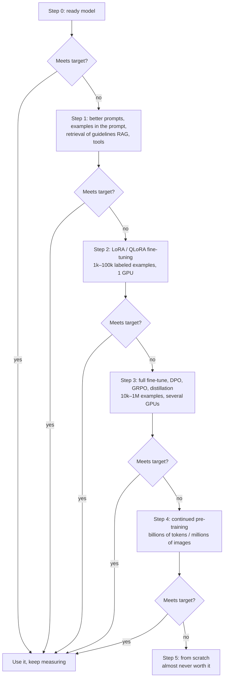
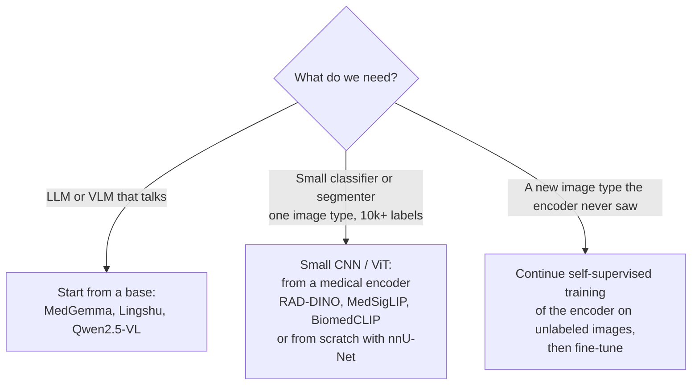
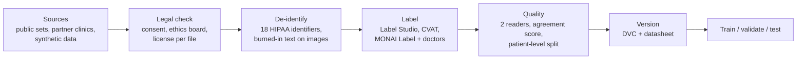
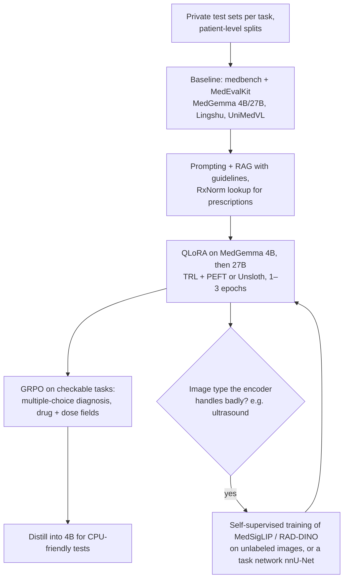

# What to do when ready models fail

The issue asks how we would *teach* a model if MedGemma, UniMedVL and the
others are not good enough. This page covers fine-tuning, training from
scratch or from a base, collecting data, and getting more out of the same
data. Every choice comes with pros and cons. The full notes, with numbers
and sources, are in
[`research-notes/training-and-data.md`](research-notes/training-and-data.md).
Section numbers below (§) point there.

## 1. First, decide what "fail" means

A model fails only when it is measured on **our** test set and misses a
target we wrote down *before* testing. Without that we cannot tell whether
training helped.

| Task | Metric (what we count) | Floor (no model) | Example target |
| --- | --- | --- | --- |
| Diagnosis from symptoms | top-1 / top-5 accuracy: is the true disease first / in the first 5? | top-5 = 1.00 for the Bayes reference on the toy table | top-5 ≥ 0.90 on real cases (DDXPlus) |
| OCR of histories | CER: share of wrong characters | 0.98 | CER ≤ 0.05 |
| Handwritten prescriptions | drug + strength recall: share of drugs read with the right dose | 0.00 | ≥ 0.95, and **every** dose error goes to a human |
| X-ray / MRI / ultrasound | sensitivity (finds sick cases) and specificity (clears healthy ones) | 0.00 / 1.00 | sensitivity ≥ 0.90 at specificity ≥ 0.80 |

`medbench` already computes all of these
([`src/medbench/metrics.py`](../../../src/medbench/metrics.py)) and gives a
95% confidence interval, so "better" means "better beyond the noise".

## 2. The ladder: cheapest step first

Each step up costs about 10 times more data, money or time (§1).

| Step | What changes | Pros | Cons | Real example |
| --- | --- | --- | --- | --- |
| 1. Prompting, RAG, tools | Nothing in the model; we change what we send it | Hours of work, no GPU for training, easy to undo | Limited by what the model already knows; long prompts are slower | Medprompt took GPT-4 to 90.2% on MedQA without training; MedRAG gave up to +18% |
| 2. LoRA / QLoRA | Small adapter matrices, under 1% of weights | One 24 GB GPU for 27B (QLoRA, 19.6 GB); adapters are a few MB; the base stays intact | Smaller gains than full training on very new tasks | Google's MedGemma notebook: QLoRA, 1 epoch, one 40 GB GPU |
| 3a. Full fine-tune | All weights | Biggest gains on a new task | 16 bytes per weight: 71 GB for 4B, 442 GB for 27B; risk of forgetting | Most medical models from a base |
| 3b. DPO (preferences) | All weights or LoRA | Teaches "this answer is better than that one"; no reward model | Needs pairs of answers ranked by doctors | – |
| 3c. GRPO / RL with checkers | All weights or LoRA | Works with little data when an answer can be checked automatically (multiple choice, field extraction) | Needs a good checker; can learn to game it | MedVLM-R1: 600 samples, 55% → 78% |
| 3d. Distillation | A small model learns from a big one | A 4B model that runs on CPU and talks like 27B | Inherits the teacher's mistakes | MedGemma's text skills came from distillation from a large teacher |
| 4. Continued pre-training | The model reads lots of unlabeled medical text or images | New vocabulary, new image types | Weeks of GPU time; needs huge clean data | MEDITRON: 48.1B tokens on Llama 2 |
| 5. From scratch | Everything | Full control of data and license | About 61 000 H100-hours ($150–250k) for a 27B LLM; weaker general knowledge | Rarely used for medical LLMs today |

## 3. From scratch or from a base?

**Recommendation:** never train a large language or vision-language model
from scratch in this project. Start from the base that is closest to the
task (§4.3). Rule of thumb: a model needs about **20 tokens of text per
parameter** to be trained well from scratch (Chinchilla). For 7B that is
140 billion tokens, far more medical text than any clinic has.

## 4. Collecting a dataset

| Choice | Pros | Cons |
| --- | --- | --- |
| Public datasets (starter set in [research-notes/datasets.md](research-notes/datasets.md)) | Free, known baselines | Licenses are often non-commercial or "laundered" on Kaggle and HF; may not look like our clinic's data |
| Partner clinic data | Matches the real task | Ethics approval, contracts, de-identification, months of work |
| Federated learning (Flower, NVIDIA FLARE) | Data never leaves the hospital | Hard to debug; needs IT at every site |
| Synthetic data (Synthea, rendered documents, phantoms, diffusion) | No privacy risk, unlimited amount | The model can learn the generator's shortcuts; never use it as the **test** set (our tests use real open files, [data-sources.md](data-sources.md)) |
| Doctors label from scratch | Best labels | Slow and expensive |
| Weak labels from reports (NLP over radiology reports) | Cheap, large | Noisy; check a sample by hand |
| Active learning (model picks the hardest cases for doctors) | Spends expert time where it helps most | Needs a working model first |

Pitfalls (§6.5, §6.6):

* **Split by patient, not by image.** The same patient in train and test
  makes scores look far too good.
* **Hospital shortcuts.** Zech et al. found that pneumonia models learned to
  recognize *the hospital* (from markers and scanner style) instead of the
  disease. Test on a hospital the model never saw.
* **Check fairness** by age, sex and scanner.
* **MIMIC and other credentialed data** must never be sent to online LLM
  APIs.

## 5. Making more data, and using the same data better

| Method | What it does | Pros | Cons |
| --- | --- | --- | --- |
| Safe image augmentation (§7.1): small rotation, shift, contrast, noise, MRI artifacts (TorchIO) | New versions of the same image with the same label | Free, proven | **No left-right flip on chest X-ray**: the heart moves and the side of every finding changes |
| Text augmentation (§7.3): OCR noise (`0`↔`O`, `1`↔`l`), synonyms, rendering in many fonts and handwriting styles | More varied documents | Cheap, targets real OCR mistakes | Can create impossible doses; check with RxNorm |
| Synthetic images (§7.2): diffusion (RoentGen), UniMedVL generation | Rare findings on demand | RoentGen added about 5% for chest X-ray classifiers | Fake anatomy; must be checked by experts; never in the test set |
| Self-supervised pre-training (§7.4) | Learn from unlabeled images first | Uses the huge pile of unlabeled scans | GPU-heavy |
| Several epochs (§7.5) | Show the same data again | Up to 4 epochs is nearly as good as new data (Muennighoff et al. 2023) | For small fine-tuning sets use 1–3 epochs and stop early: overfitting comes fast |
| Class balancing (§7.6): weighted or focal loss, oversampling, threshold tuning | Rare diseases get more attention | Simple | Can over-predict rare diseases |
| Multi-task training (§7.7) | One model learns related tasks together | Shared knowledge, fewer models | Tasks can fight each other |

The repository already has small, tested versions of the safe augmentations
in [`src/medbench/augment.py`](../../../src/medbench/augment.py):

* `flip_horizontal` swaps the `side` label too.
* `safe_image_augmentations` lists the safe changes per image type.
* `ocr_noise` uses medically relevant character confusions.
* `synonym_swap` rewrites symptom text.

## 6. Evaluation, safety and rules (§8)

* Keep a **private, never-augmented test set**, and report confidence
  intervals, not single numbers.
* Measure **calibration** (does "90% sure" mean right 90% of the time?) and
  make the model say "I don't know".
* Red-team for dangerous answers: wrong doses, missed emergencies.
* **Regulation** (not legal advice): software that diagnoses is a medical
  device. In the US, the FDA allows a *predetermined change control plan*
  (PCCP, final guidance December 2024) for planned retraining. In the EU,
  the AI Act's high-risk rules for medical devices apply from 2 August 2028
  (moved by the 2026 Digital Omnibus). Health data is a special category under GDPR
  Article 9. None of the models in this study is cleared for clinical use.

## 7. Our concrete plan if the ready models fail

Resources for each step come from `medbench estimate --finetune` (see
[measurements.md §7](measurements.md#7-fine-tuning-memory-medbench-estimate---finetune)):

* QLoRA of 4B: about 5 GB of GPU memory, so any modern GPU will do.
* QLoRA of 27B: about 20 GB, so one L4 or RTX 4090.
* LoRA of 27B in bf16: about 60 GB, so one A100 or H100 80 GB.
* Compute is about 6 × parameters × tokens. A LoRA run of 27B on 10M tokens
  is roughly 1.1 H100-hours (about $3–5 to rent).
