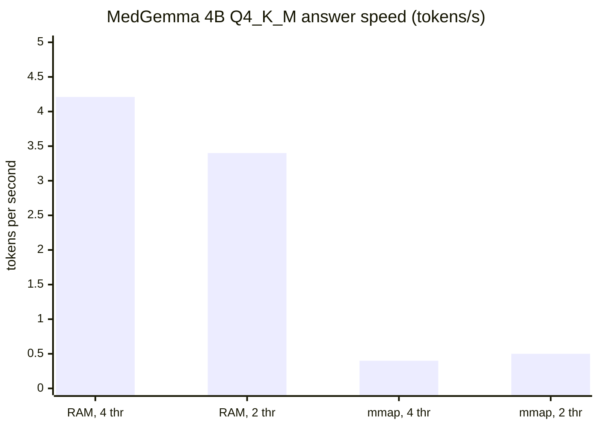

# Measurements: how fast do the models run here?

This page lists what was **measured** on the development machine and what
was **calculated** with `medbench estimate`. Raw outputs are in
[`data/`](data/). Measured numbers come first, because the calculator is
only a model and the measurements are what tell us whether to trust it.

## 1. The machine

| Thing | Value | How we know |
| --- | --- | --- |
| CPU | 6 vCPU, AMD EPYC (AVX2, no AVX-512) | `medbench host`, llama.cpp log |
| RAM the OS sees | 12.5 GB (11 960 MiB) | `free -m` |
| RAM this job may use | **2 990 MiB** | `/sys/fs/cgroup/memory.max` |
| GPU | none | `medbench host` |
| One-thread copy speed | 16.0 GB/s (one run gave 2.1 GB/s when the VM was busy) | [`experiments/issue_1_memory_bandwidth.py`](../../../experiments/issue_1_memory_bandwidth.py) |

The key number is the **2 990 MiB cgroup limit**. MedGemma 4B in 4-bit is
2 368 MiB of weights plus an 812 MiB vision part, so the whole model does
**not** fit in the memory we are allowed to use, even though the machine has
12.5 GB. Everything below follows from that.

## 2. MedGemma 4B, 4-bit (Q4_K_M), text only, `llama-bench`

llama.cpp build b11609 (`fcac19079`), CPU backend `libggml-cpu-haswell.so`.
"pp" means reading the prompt (prefill), "tg" means writing the answer
(decode). Both are in tokens per second. Higher is better.

| Load mode | Threads | Prompt (pp) | Answer (tg) | File |
| --- | ---: | ---: | ---: | --- |
| copy into RAM (`-lm none`) | 4 | 19.43 ± 0.02 (pp128) | **4.21 ± 1.49** (tg32) | [nommap-t24](data/llama-bench/llama-bench-4b-nommap-t24.md) |
| copy into RAM (`-lm none`) | 2 | 11.08 ± 1.83 | 3.40 ± 0.50 | same |
| copy into RAM, `--poll 0` | 2 | – | 1.80 (tg16) | [loadmode](data/llama-bench/llama-bench-4b-loadmode.md) |
| copy into RAM, `--poll 50` | 2 | – | 2.44 (tg16) | same |
| map the file (`mmap`, default) | 4 | 14.86 ± 0.48 (pp256) | **0.40 ± 0.02** (tg64) | [t4](data/llama-bench/llama-bench-4b-t4.md) |
| map the file, again | 4 | – | 0.42 (tg32) | [rerun](data/llama-bench/llama-bench-4b-tg-rerun.md) |
| map the file, again | 2 | – | 0.50 (tg32) | same |

What it means, in plain words:

* When the weights are **copied into RAM**, the 4B model writes about
  **4 words per second**. A 100-token answer takes about 25 seconds. That is
  slow, but fine for a few CI test items.
* When the weights are **mapped from disk** and the memory limit is tight,
  the kernel keeps throwing weight pages away and reading them back, so every
  new token reads part of the file from disk again. Writing becomes
  **10 times slower** (0.40 tokens/s).
* Four threads are better than two, but not twice as good. Decoding is
  limited by memory speed, not by the number of cores.
* The calculator predicted 4.3 tokens/s for this machine. We measured
  4.21. The older guess in the research notes (10–15 tokens/s) was too high.



## 3. Starting `llama-server` under the 3 GiB limit

[`experiments/issue_1_llama_server_memory_probe.sh`](../../../experiments/issue_1_llama_server_memory_probe.sh)
starts the server with different options, watches the cgroup memory and
stops it. The raw probe logs were not kept (`*.log` files are ignored by
git); the table below is their summary.

| Probe | Options | Result | Peak cgroup memory | Server RSS |
| --- | --- | --- | ---: | ---: |
| `text-mmap` | text only, mmap | healthy after 30 s | 2 990 MiB (the limit) | 2.52 GB |
| `text-mmap-norepack` | text only, mmap, `--no-repack` | healthy after 30 s | 2 990 MiB | 2.53 GB |
| `vis-mmap-fa` | + vision part, mmap, flash attention | **killed** after 26 s | 2 990 MiB | – |
| `vis-mmap-norepack-default` | + vision part, mmap, `--no-repack` | healthy after 31 s | 2 990 MiB | 2.54 GB |
| `vis-mmap-norepack` | same, flash attention | healthy after 33 s | 2 990 MiB | 2.54 GB |

Two bugs were found and fixed this way. Both fixes are in
[`scripts/medbench-model-run.sh`](../../../scripts/medbench-model-run.sh).

1. **The memory check looked at the wrong file.** The model cache uses
   symbolic links. `stat` without `--dereference` returned the size of the
   link (about 40 bytes), not the 2.4 GB file, so the script decided the
   model fits and copied it into RAM. The out-of-memory killer then stopped
   the server. Fix: `stat --dereference`. Test:
   `test_huge_model_behind_symlink_falls_back_to_mmap` in
   [`tests/test_medbench_model_run.py`](../../../tests/test_medbench_model_run.py).
2. **"Repacking" made a private copy of the weights.** On x86 llama.cpp
   rearranges (repacks) the weights for faster matrix maths. The log of the
   killed probe shows `CPU_REPACK 1458 MiB`. That memory is a private copy,
   so mmap no longer saves anything, and together with the 933 MiB vision
   part it went over the limit. Fix: pass `--no-repack` whenever the script
   uses mmap.

## 4. A real end-to-end run on this machine (stopped)

Command (same as CI, but with mmap because of the limit):

```bash
OUT_DIR=/tmp/medbench-out COUNT=2 TASKS=diagnosis \
  bash scripts/medbench-model-run.sh run
```

Console output (excerpt):

```text
[medbench-model-run] weights + 1 GiB need 4210 MiB; 1087 MiB free
[medbench-model-run] weights + 1 GiB do not fit in free memory; using mmap (slower decoding)
[medbench-model-run] llama-server healthy after 66s (threads=4, gpu layers=0, load mode=mmap)
[medbench-model-run] task diagnosis: 2 items, 1800s left
Terminated
```

Server log (excerpt):

```text
prompt processing, n_tokens =  1, progress = 0.02, t = 18.73 s / 0.05 tokens per second
prompt processing, n_tokens = 62, progress = 0.94, t = 40.60 s / 1.53 tokens per second
```

Reading a 66-token prompt ran at **1.53 tokens/s**, 13 times slower than
`llama-bench` without mmap. The process sat in the `D` state ("waiting for
disk") at the memory limit. The run was stopped by the time limit of the
background job before the first answer was written. It was **not**
restarted, because the issue asks us not to keep the development machine
busy for a long time.

Conclusion: **this VM cannot run even the 4B vision model at a useful
speed.** The GitHub-hosted runner has 16 GB of RAM, so there the same script
picks `--load-mode none` (copy into RAM). That is what the `cpu-smoke` job in
[`.github/workflows/model-tests.yml`](../../../.github/workflows/model-tests.yml)
does. Its numbers are uploaded as the `medbench-cpu-reports` artifact,
which contains `llama-timings.txt`. The real runs on GitHub wrote
**7.8–11.6 tokens/s**, two to three times as fast as this VM. See
[section 9](#9-a-real-run-on-a-github-hosted-cpu-runner).

## 5. Baseline scores without any model

`medbench run --backend naive-bayes --count 50` (seed 0, takes under a
second):

| Task | Score | Meaning |
| --- | --- | --- |
| diagnosis | top-1 0.92 (95% CI 0.84–0.98), top-5 1.00, MRR 0.96 | Best possible ranking: the cases are made from known probabilities |
| ocr-prescription | CER 0.97, WER 1.00, drug + strength recall 0.00 | No text produced: the worst score |
| ocr-history | CER 0.98, WER 1.00 | same |
| imaging-xray / mri / ultrasound | accuracy 0.50, sensitivity 0.00, specificity 1.00 | Always says "no finding": coin-flip level |

So a real model should come close to **0.92 top-1** on diagnosis, have a
character error rate (CER) **well below 0.97** on documents, and an accuracy
**well above 0.50** on images.

## 6. Calculated speed and memory (`medbench estimate`)

The calculator ([`src/medbench/resources.py`](../../../src/medbench/resources.py))
uses two simple rules:

* **Writing the answer** reads all active weights once per token, so
  `tokens/s ≈ memory speed × efficiency ÷ bytes of weights`.
* **Reading the prompt** is limited by compute:
  `tokens/s ≈ FLOPS × efficiency ÷ (2 × parameters)`.

The efficiency numbers for the two CPU profiles were tuned to real runs:
the dev VM to `llama-bench` in section 2, and the GitHub runner to the
`cpu-smoke` job in [section 9](#9-a-real-run-on-a-github-hosted-cpu-runner).
On a CPU, the llama.cpp image encoder reaches a much smaller share of peak
compute than the text model, so a profile can set its own
`vision_efficiency`. The GPU numbers use datasheet bandwidth and should be
checked on the first GPU run.

4-bit weights (Q4_K_M), 512 prompt tokens, 1 image, 256 answer tokens. "Fits"
compares against the RAM or VRAM of the profile. Raw output:
[`data/estimates.txt`](data/estimates.txt).

| Model | Hardware | Memory (GB) | Fits | Prompt tok/s | Answer tok/s | Seconds per request |
| --- | --- | ---: | :---: | ---: | ---: | ---: |
| MedGemma 4B | GitHub CPU (4 vCPU, 16 GB) | 3.8 | yes | 31 | 7.8 | 114 |
| MedGemma 4B | this dev VM (3 GiB limit) | 3.8 | **no** | 17 | 4.3 | 127 |
| MedGemma 4B | T4 16 GB | 3.8 | yes | 3 023 | 69 | 4 |
| MedGemma 4B | L4 24 GB | 3.8 | yes | 5 628 | 65 | 4 |
| MedGemma 4B | RTX 4090 24 GB | 3.8 | yes | 7 674 | 218 | 1.3 |
| MedGemma 4B | A100 80 GB | 3.8 | yes | 14 512 | 442 | 0.7 |
| MedGemma 4B | H100 80 GB | 3.8 | yes | 46 000 | 725 | 0.4 |
| MedGemma 27B | GitHub CPU | 18.3 | **no** | 4.8 | 1.2 | 420 |
| MedGemma 27B | this dev VM | 18.3 | **no** | 2.7 | 0.7 | 675 |
| MedGemma 27B | T4 16 GB | 18.3 | **no** | 474 | 11 | 25 |
| MedGemma 27B | L4 24 GB | 18.3 | yes | 882 | 10 | 26 |
| MedGemma 27B | RTX 4090 24 GB | 18.3 | yes | 1 203 | 35 | 8 |
| MedGemma 27B | A100 80 GB | 18.3 | yes | 2 275 | 71 | 4 |
| MedGemma 27B | H100 80 GB | 18.3 | yes | 7 211 | 116 | 2 |
| UniMedVL (14B, 7B active) | GitHub CPU | 10.0 | yes | 17 | 4.5 | 214 |
| UniMedVL | this dev VM | 10.0 | **no** | 10 | 2.5 | 308 |
| UniMedVL | T4 16 GB | 10.0 | yes | 1 711 | 40 | 8 |
| UniMedVL | L4 24 GB | 10.0 | yes | 3 184 | 38 | 7 |
| UniMedVL | RTX 4090 24 GB | 10.0 | yes | 4 342 | 127 | 2 |
| UniMedVL | A100 80 GB | 10.0 | yes | 8 211 | 257 | 1 |
| UniMedVL | H100 80 GB | 10.0 | yes | 26 026 | 422 | 1 |

UniMedVL has no 4-bit GGUF file today, so its rows are what a 4-bit version
*would* need. The real bf16 checkpoint is 29 GB and needs a 40 GB+ GPU or
two 24 GB GPUs.

Unquantized (bf16) on an A100 80 GB: MedGemma 4B needs 9.7 GB and writes
about 140 tokens/s. MedGemma 27B needs 56.3 GB and writes about 22 tokens/s.
UniMedVL needs 30.2 GB.

### What a CI run costs

The CPU smoke test with 3 tasks × 2 items took **6–8 minutes** on GitHub
(about 6 s per text request, 66–89 s per image request; section 9). It fits in
the 60-minute job limit with room to spare. The old full set (6 tasks × 20 items
= 120 requests: 20 text and 100 image requests) would take about
20 × 6 s + 100 × (75–90) s ≈ **2–2.5 hours** on a hosted CPU runner with the 4B
model. That is inside GitHub's 6-hour limit, but it is slow and says little,
because 4B missed even the simple drawn X-ray phantoms of the first version. 27B does not fit in 16 GB at
all. On one L4 the full set takes about 120 × 26 s ≈ **52 minutes for 27B**
and **8 minutes for 4B**. That is why the full tests run on the GPU job
only.

## 7. Fine-tuning memory (`medbench estimate --finetune`)

Batch 1, sequence 2 048, LoRA rank 16 on attention and MLP, gradient
checkpointing on, AdamW. Raw output:
[`data/finetune-estimates.txt`](data/finetune-estimates.txt).

| Model | Full fine-tune | LoRA (bf16 base) | QLoRA (4-bit base) | LoRA trainable parameters |
| --- | ---: | ---: | ---: | ---: |
| MedGemma 4B | 71.0 GB | 11.3 GB | **4.9 GB** | 29.2 M |
| UniMedVL | 236.0 GB | 32.2 GB | 10.5 GB | 33.7 M |
| MedGemma 27B | 442.5 GB | 60.3 GB | **19.6 GB** | 112 M |

Plain-English reading:

* **Full fine-tuning** changes every weight, so it also stores gradients and
  optimizer state for every weight: about 16 bytes per parameter. Even 4B
  needs a whole A100 80 GB. 27B needs a cluster.
* **LoRA** freezes the model and trains small "adapter" matrices (under 1% of
  the weights). Memory is mostly the frozen weights.
* **QLoRA** also stores the frozen weights in 4 bits. MedGemma 27B fits on a
  single 24 GB card (L4 or RTX 4090), and 4B fits on almost any GPU.

More detail on compute and money for training is in
[`research-notes/hardware-and-ci.md`](research-notes/hardware-and-ci.md) and
[`if-models-fail.md`](if-models-fail.md).

## 8. How to repeat these measurements

```bash
pip install -e ".[dev]"
python -m medbench.cli host                 # what the calculator sees
bash scripts/medbench-model-run.sh download # llama.cpp + MedGemma 4B, pinned SHA-256
LD_LIBRARY_PATH=.cache/medbench/llama-b11609-f95cbb27dd6e \
  nice -n 10 .cache/medbench/llama-b11609-f95cbb27dd6e/llama-bench \
  -m .cache/medbench/models/fa17ea2647ef/medgemma-4b-it-Q4_K_M.gguf \
  -t 4 -p 128 -n 32 -lm none                # section 2
bash experiments/issue_1_llama_server_memory_probe.sh text-mmap   # section 3
python -m medbench.cli estimate --model medgemma-27b-it --hardware l4-24gb \
  --quant Q4_K_M --images 1                 # section 6
python -m medbench.cli estimate --model medgemma-27b-it --hardware a100-80gb \
  --quant bf16 --finetune                   # section 7
```

The probe script reads `LLAMA_DIR`, `MODEL`, `MMPROJ` and `LOG_DIR` from the
environment; its defaults match the cache written by `download`. Run heavy commands with `nice` and a small `-n`, as above,
so the machine stays usable.

## 9. A real run on a GitHub-hosted CPU runner

The `cpu-smoke` job of the Model Tests workflow ran twice on pull request
commits, with the same model, script and inputs:
[run 38550186566](https://github.com/konard/medical-neural-network-ml/actions/runs/38550186566) (run A) and [run 38552481450](https://github.com/konard/medical-neural-network-ml/actions/runs/38552481450) (run B). Their
artifacts are saved in
[`data/ci-cpu-smoke-38550186566/`](data/ci-cpu-smoke-38550186566/) and
[`data/ci-cpu-smoke-38552481450/`](data/ci-cpu-smoke-38552481450/).

```text
[medbench-model-run] weights + 1 GiB need 4210 MiB; 13963 MiB free
[medbench-model-run] llama-server healthy after 4s (threads=3, gpu layers=0, load mode=none)
```

The runner had enough free memory, so the weights were copied into RAM, and
the server started in 4 s (66 s with mmap on the dev VM). The script leaves
one of the 4 vCPUs free, so it used 3 threads.

### Speed

From `llama-timings.txt` of each run. "Text" is the 2 diagnosis requests
plus the text request of `tests/test_real_models.py`. "Image" is the 2 X-ray
and 2 prescription requests plus the image request of the same test file.

| Request | Prompt tokens | Prompt time, run A | Prompt time, run B | Answer speed, run A | Answer speed, run B |
| --- | ---: | ---: | ---: | ---: | ---: |
| Text (3 requests) | 66–68 | 2.0–2.2 s (**30–33 tokens/s**) | 2.5–2.6 s (25–27 tokens/s) | 7.9–8.0 tokens/s | 11.6 tokens/s |
| One image (5 requests) | 288–307 | 65.8–66.7 s (**4.4–4.6 tokens/s**) | 83.6–84.5 s (3.4–3.6 tokens/s) | 7.6–7.8 tokens/s | 10.8–11.3 tokens/s |
| Whole `Run medbench` step | | 377 s | 458 s | | |

* **Writing the answer: 7.6–11.6 tokens/s**, two to three times the dev VM
  (4.2 with 4 threads). The calculator used to say 4.3 for the runner; it
  is now tuned to run A.
* **Reading an image costs about 56–74 s.** A text prompt of 300 tokens
  would take about 10–12 s. The rest is the image encoder (SigLIP,
  896 × 896 pixels), which llama.cpp runs much less efficiently on CPU than
  the text model. On CPU, image tasks are slow because of image reading, not
  answer writing.
* **Hosted runners are not all the same machine.** Run B wrote answers 45%
  faster but read images 27% slower than run A. GitHub does not say which
  CPU a runner gets, so timing tests in CI need a wide margin, and speed
  comparisons between models must run on the same machine.

### Scores

These runs used the inputs of the first version, which were generated by
code: a toy diagnosis table, prescriptions rendered in a handwriting-style
font and drawn X-ray phantoms. They were later replaced by real, openly
licensed files ([data-sources.md](data-sources.md)). 2 items per task, so
the scores show that the pipeline works, not how good the model is:

| Task | Run A | Run B | Mean time per item, A / B |
| --- | --- | --- | ---: |
| diagnosis | top-1 1.0, top-5 1.0, MRR 1.0 | same | 6.5 s / 5.7 s |
| ocr-prescription | CER 0.010, WER 0.056, drug + strength recall 1.0 | CER 0.051, WER 0.222, drug + strength recall 0.67 | 73.0 s / 88.8 s |
| imaging-xray | sensitivity 0.0, specificity 0.0, accuracy 0.0 | same | 67.9 s / 85.4 s |

**The same model gave a different answer to the same image.** For the
second prescription, run A read "levothyroxine 25 mcg tablet TiD x 3 days"
and run B read "I evothyr oxin n° 25 mfg tablet TiDx 3 days". Decoding is
greedy in both runs, so the reason is the CPU: different machines add
floating-point numbers in a different order, a near tie between two tokens
flips, and the rest of the answer follows the new token. So OCR scores need
many items and confidence intervals, and a regression test must not expect
one exact string from a real model. A third run
([38553921579](https://github.com/konard/medical-neural-network-ml/actions/runs/38553921579),
353 s for the medbench step) gave run A's answers again: CER 0.0102,
diagnosis 2/2 and X-ray 0/2.

The X-ray result was checked by hand with the first version of
[`experiments/issue1_xray_truth.py`](../../../experiments/issue1_xray_truth.py)
(it now prints the labels of the real images), and both runs gave the same
answers:

| Item | Truth | Model answer | Verdict |
| --- | --- | --- | --- |
| xray-00000 | nodule in the patient's right lung | "No" | missed finding |
| xray-00001 | no finding | "Yes, there is a round lung nodule in the patient's right lung." | false alarm |

The answers were read correctly; the model was wrong on both images. The
phantom was a few ellipses, not a real X-ray, so this does not say how
MedGemma reads real chest films. This is one reason the drawn images were
replaced by real, openly licensed X-rays ([data-sources.md](data-sources.md)).
It does show why one score from 2 items means nothing, and why Phase 2 of the [research plan](research-plan.md) uses
public X-rays with many items and confidence intervals.

The two real-model tests in `tests/` (one text request and one image
request) passed in 76 s (run A) and 92 s (run B). The whole job took
7.5–8.5 minutes including the download, well inside its 60-minute limit.

## 10. The first run on real, openly licensed files

After the review of this pull request, the generated inputs were replaced by
real files ([data-sources.md](data-sources.md)). The `cpu-smoke` job then ran
MedGemma 4B Q4_K_M on 2 items each of DDXPlus diagnosis, chest X-ray and
handwritten prescription words
([run 38714694090](https://github.com/konard/medical-neural-network-ml/actions/runs/38714694090),
reports and `ATTRIBUTION.md` in
[`data/ci-cpu-smoke-38714694090/`](data/ci-cpu-smoke-38714694090)). The
`real-data` job of the same run restored all 40 files from the Actions cache
and checked their hashes, licenses and labels (40 network tests passed); the
whole job took 27 s.

| Item | Truth | Model answer | Verdict |
| --- | --- | --- | --- |
| `ddxplus-test-0` (49-year-old woman) | GERD | 1. GERD, 2. Bronchitis, 3. Influenza, … | right, rank 1 |
| `ddxplus-test-1` (2-year-old boy) | Bronchitis | 1. Bronchiolitis, 2. Bronchitis, … | rank 2 |
| `xray-pneumothorax-1` | pneumothorax, left | "abnormal: yes, finding: Left pneumothorax, side: left" | right |
| `xray-normal-1` | normal | "abnormal: no, finding: none" | right |
| `rx-word-p0007` | Napa | "Napa" | right |
| `rx-word-p1126` | Dexter 60 | "depxe 60" | drug name wrong |

Scores: DDXPlus top-1 0.5, top-3 1.0, MRR 0.75 (the DDXPlus expert system's
own first guess was right on 0 of the 2); X-ray sensitivity 1.0 and
specificity 1.0; prescription CER 0.167, WER 0.25, drug-name recall 0.5.

Speed matched section 9: text prompts were read at about 27.5 tokens/s and
answers written at 10.6–11.0 tokens/s. Each image took 83–85 s to read
(3.5–3.8 prompt tokens/s), so one image request took about 84–86 s. The
medbench step took 490 s and the whole job 9.5 minutes.

On real files the 4B model found the pneumothorax and its side, while it
had missed both drawn phantoms. But 2 items per task are still only a
pipeline check: 95% confidence intervals span almost the whole 0–1 range.
Accuracy needs the GPU job with all items per task.
