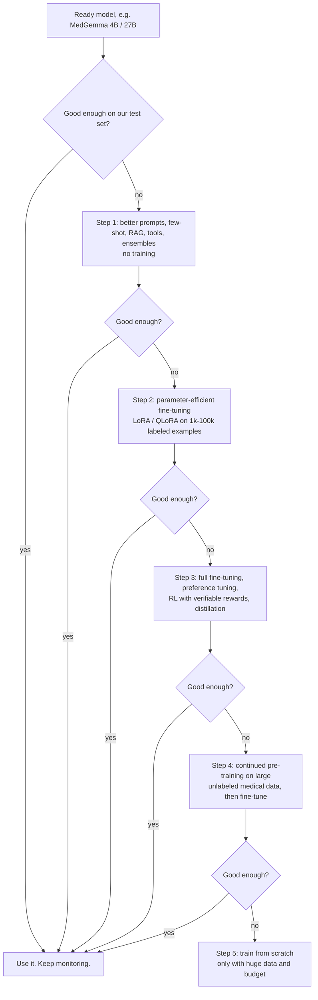
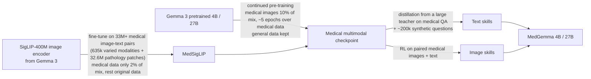
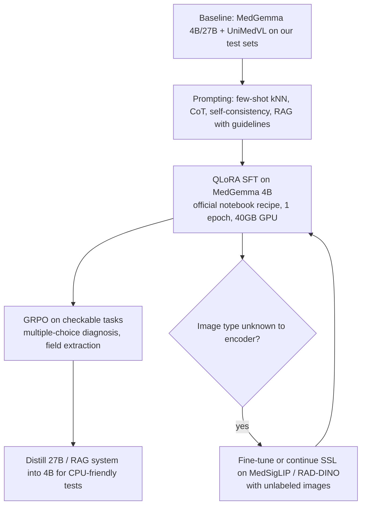

# Research notes: what to do when ready models are not good enough

> Part of the case study for
> [issue #1](https://github.com/konard/medical-neural-network-ml/issues/1).
> Collected on 2026-10-14. Facts link to sources (list at the end).
> Facts marked **(unverified)** could not be checked against a primary
> source. Treat them as hints, not as facts.

This file answers these questions from the issue:

- What do we do if ready models (MedGemma, UniMedVL, ...) fail?
- How do we fine-tune, or train our own model from scratch or from a good base?
- How do we collect a dataset?
- How do we "multiply" data, or use the same data so the model learns more?
- Which libraries already exist?
- How do we check that the result is good and safe?

The text uses simple English. Each method has: a one-line explanation, pros,
cons, and when to use it.

---

## 0. Small dictionary (read this first)

| Word | Simple meaning |
|---|---|
| Model | A program with millions or billions of numbers ("weights") that turns input (text, image) into output. |
| Weights / parameters | The numbers inside the model. Training changes them. |
| Training | Showing the model many examples and changing weights so its answers get better. |
| Pre-training | The first, very big training on general data (for example, the whole internet). Very expensive. |
| Fine-tuning | Extra, smaller training of an already trained model on our own data. |
| Base model | The model we start from. |
| Token | A piece of a word. "Pneumonia" may be 2-3 tokens. Models count text in tokens. |
| Epoch | One full pass over the training data. |
| Label | The correct answer for one example (for example "pneumonia: yes"). |
| Overfitting | The model memorizes the training data and fails on new data. |
| Catastrophic forgetting | After fine-tuning, the model forgets what it knew before. |
| GPU / VRAM | Graphics card that makes training fast / its memory. Memory is usually the limit. |
| Validation / test set | Data the model never trained on. We use it to measure quality honestly. |
| Inference | Using the trained model to get answers. |

---

## 1. The big picture: a ladder from cheap to expensive

The main rule: **always try the cheapest step first. Go up only when the
cheaper step fails on our test set.** Each step up costs about 10x more
money, data, or time.

| Step | Data needed | Compute needed | Typical time |
|---|---|---|---|
| 0. Use ready model | Only a test set (100-1,000 cases) | Inference only | Days |
| 1. Prompting / RAG / tools | Test set + documents (guidelines) | Inference only | Days-weeks |
| 2. LoRA / QLoRA | 1,000-100,000 labeled examples | 1 GPU with 24-80 GB | Hours-days |
| 3. Full FT / RL / distillation | 10,000-1,000,000 examples | Several GPUs | Days-weeks |
| 4. Continued pre-training | Billions of tokens / millions of images | Dozens-hundreds of GPUs | Weeks |
| 5. From scratch | Hundreds of billions of tokens | Hundreds-thousands of GPUs | Months |

The data and compute numbers in this table are rough ranges for planning,
built from the examples later in this file. They are not exact rules.

---

## 2. Adapting a model WITHOUT training

These methods do not change the weights. They change what we send to the model.
They are cheap and fast to try, so they come first.

### 2.1 Methods

| Method | Simple explanation | Pros | Cons | When to use |
|---|---|---|---|---|
| Zero-shot prompting | Ask the question directly, with clear instructions. | Free, instant. | Results depend a lot on wording. | Always, as the first baseline. |
| Few-shot prompting | Put a few solved examples in the prompt. | Teaches output format; often more accurate. | Uses context space; examples can bias the answer. | When output format or style is wrong. |
| Dynamic few-shot (kNN) | For each new question, find the most similar solved examples automatically and put them in the prompt. | Better than fixed examples. | Needs a pool of labeled examples and an embedding model. | When we have a few hundred labeled cases. |
| Chain-of-thought (CoT) | Ask the model to "think step by step" before the answer. | Helps reasoning tasks like differential diagnosis. | Longer, slower answers; reasoning can look right but be wrong. | Diagnosis, multi-step questions. |
| Self-consistency / ensembles | Ask the same question several times (or to several models) and take the majority answer. | More stable, often more accurate. | Costs N times more inference. | When accuracy matters more than speed. |
| Choice shuffling | For multiple-choice, shuffle the options in each run, then vote. | Removes "position bias". | Only for multiple-choice. | Benchmarks, structured questions. |
| RAG (retrieval-augmented generation) | Search a trusted library (guidelines, textbooks) and paste the found text into the prompt. | Up-to-date facts; can cite sources; fewer made-up facts. | Needs a good search index; bad search gives bad answers; long context can confuse the model ("lost in the middle"). | Questions needing medical knowledge and guidelines. |
| Tool use / agents | Let the model call tools: calculators, drug databases, OCR, image segmenters. | Exact numbers from tools; mixes strengths of several models. | More moving parts; harder to test. | Dose calculations, lookups, multi-step workflows. |
| Constrained output | Force JSON or a fixed list of answers (grammar / schema). | Easy to parse and test automatically. | Can lower quality if too strict. | All automated pipelines. |

### 2.2 Proven numbers

- **Medprompt (Microsoft, 2023)** uses only prompting on GPT-4, with no training. It has three parts:
  (1) dynamic few-shot: the 5 most similar training questions, found with kNN over text embeddings;
  (2) self-generated chain-of-thought, kept only when its final answer matches the true label;
  (3) choice-shuffle ensemble: 5 runs, then majority vote.
  Result: **90.2% on MedQA**. That is a 27% lower error rate than the best earlier specialist
  model, and it beat Med-PaLM 2 (a fine-tuned medical model) with far fewer model calls.
  Ablation gains on MedQA: CoT +3.4 points, few-shot +2.2, shuffle ensemble +2.2.
  With 20 examples and 11 ensemble runs it reached 90.6%. [S1]
- **Med-PaLM 2** (fine-tuned PaLM 2 plus "ensemble refinement" prompting) reached up to 86.5% on MedQA. [S2]
- **MedRAG / MIRAGE benchmark (2024)**: 7,663 questions from 5 medical QA datasets and 41
  combinations of corpus, retriever, and model. RAG improved six LLMs by **up to 18%** over plain
  chain-of-thought, and raised GPT-3.5 and Mixtral to about GPT-4 level. Combining several medical
  corpora and retrievers worked best. The authors also saw "lost-in-the-middle" effects. [S3]
- **MedGemma 27B** reports its MedQA score of 87.7 "with test-time scaling", so even the model makers use
  inference-time tricks to get top scores. [S4]

**Lesson:** a lot of quality can come from prompting and retrieval alone. Medprompt
beat a fine-tuned medical model this way. We must measure these methods before we train anything.

---

## 3. Fine-tuning methods

Fine-tuning changes the model's weights using our data.

### 3.1 Which part of the weights do we change?

| Method | Simple explanation | Pros | Cons | When to use |
|---|---|---|---|---|
| Full fine-tuning | Change all weights. | Highest possible quality; learns the most. | Needs much GPU memory (weights + gradients + optimizer state, roughly 4x model size or more); most forgetting; one full copy per task. | Large data (100k+ examples), big budget, big change of behavior. |
| LoRA (Low-Rank Adaptation) | Freeze the model and train two small extra matrices beside each layer. | For GPT-3 175B: 10,000x fewer trainable parameters and 3x less GPU memory; no extra delay at inference (can be merged in). [S5] Forgets less than full FT. [S6] | Learns less than full FT, especially for continued pre-training. [S6] | Default first choice for fine-tuning. |
| QLoRA | LoRA, with the frozen base model stored in 4-bit (NF4), plus "double quantization" and "paged optimizers". | Fine-tuned a 65B model on a single 48 GB GPU in about 24 hours; Guanaco reached 99.3% of ChatGPT on the Vicuna benchmark. [S7] | Slower per step than LoRA; small quality loss possible; needs bitsandbytes and a supported GPU. | When GPU memory is small. Google's official MedGemma fine-tuning notebook uses QLoRA. [S8] |
| DoRA | Split each weight into "size" (magnitude) and "direction"; LoRA updates only the direction. | Closer to full FT quality than LoRA, with no extra inference cost (paper claim). [S9] | Newer and less tested; a bit slower to train. | When LoRA plateaus. |
| Adapters (Houlsby) | Insert small new layers inside each block and train only those. | Small per-task files. | Adds some inference delay (unlike LoRA). [S5] | Many tasks on one shared base. |
| Prefix / prompt tuning | Learn a few "virtual tokens" put before the input. | Tiny number of parameters. | Usually weaker than LoRA on hard tasks. | Very small budgets, many tasks. |
| Freeze vision encoder, train language part | In image+text models, keep the image "eyes" fixed and tune only the text "brain" (or the connector). | Cheap; keeps good image features; fewer images needed. | Cannot learn new visual details the encoder never saw (e.g. a new imaging type). | Same image types the model knows (chest X-ray, skin photos). |
| Tune the vision encoder too | Also update the image encoder (fully or with LoRA). | Can learn new image types, small details, higher resolution. | Needs many more images; risk of breaking general vision. | New modality (e.g. ultrasound video, rare stain) or when frozen-encoder FT fails. |

### 3.2 What kind of training signal?

| Method | Simple explanation | Data needed | Pros | Cons | When to use |
|---|---|---|---|---|---|
| Continued pre-training (domain-adaptive pre-training, DAPT) | Keep training the base model on lots of raw medical text/images (no labels) the same way it was first trained. | Millions to billions of tokens / images, unlabeled. | Teaches medical words and image patterns; gains even in low-resource settings; task-adaptive pre-training (TAPT) on the task's own unlabeled data helps even more. [S10] | Expensive; can cause forgetting, so mix in some general data ("replay"). | Domain or language that is very different (e.g. local-language clinical notes). |
| Instruction tuning / SFT (supervised fine-tuning) | Show (question, ideal answer) pairs. | 1k-100k pairs. | Simple, stable, well supported. | Copies the style of the answers, including mistakes; can overfit. | Teach a format or task (e.g. "extract drugs from prescription as JSON"). |
| RLHF with PPO | Train a "reward model" from human preferences, then improve the model with RL against it. | Thousands of human comparisons. | Very flexible. | Complex, unstable, needs several model copies in memory. | Only for large teams. |
| DPO | Learn directly from pairs "answer A is better than answer B", with a simple classification-like loss. No reward model and no RL loop. | Thousands of preference pairs. | Stable, simple, cheap; as good as or better than PPO in the paper. [S11] | Needs paired preferences; can over-optimize. | Make answers safer or more useful after SFT. |
| ORPO | Combines SFT and preference learning in one step, with no reference model. | Preference pairs. | One training run instead of two; less memory. [S12] | Newer; in TRL it is marked "experimental". [S13] | Small budget preference tuning. |
| KTO | Learns from simple "good" / "bad" labels on single answers (no pairs needed). | Thumbs up / down per answer. | Easy to collect from clinician feedback; matched or beat preference methods at 1B-30B in the paper. [S14] (unverified, secondary source) | Less studied in medicine. | When doctors only mark answers as OK / not OK. |
| RL with verifiable rewards (GRPO) | Model makes several answers; a program checks each one (right/wrong); the model is pushed toward the above-average ones. No separate "critic" model. [S15] | Questions with checkable answers (multiple choice, codes, numbers). | Strong reasoning gains with little data; generalizes well. | Needs an automatic checker; reward hacking possible; training is slower than SFT. | Diagnosis multiple choice, coding (ICD), extraction with exact answers. |
| Knowledge distillation | A big "teacher" model writes answers (or probabilities) and a small "student" learns to copy them. | Unlabeled questions + teacher access. | Small fast model with much of the teacher's skill; cheap labels. | Student copies teacher errors; check teacher's license terms. | We need a small model for CPU / edge, and a big good model exists. |
| Model merging | Average or combine the weights of several fine-tuned models (model soups, TIES, DARE, SLERP). | None (only models). | No training needed; runs on CPU or 8 GB VRAM. [S16] | Unpredictable; models must share the same base. | Combine a "medical" and a "general" fine-tune. |

### 3.3 Medical examples of RL working well with little data

- **MedVLM-R1 (2025):** base model Qwen2-VL-2B, trained with GRPO on only **600 MRI** question-image pairs.
  Accuracy went from 55.11% to 78.22% across MRI, CT, and X-ray. Compared with SFT on the same data:
  MRI 95.33 vs 94.00, CT 70.33 vs 54.33, **X-ray 69.00 vs 34.00**. So RL generalized much better to
  image types it never trained on. [S17]
- **HuatuoGPT-o1 (2024):** about 40K "verifiable" medical problems. Stage 1: search for long reasoning
  paths, checked by a verifier, and use them for SFT. Stage 2: RL with verifier-based rewards.
  It beat general and medical baselines. [S18]
- **MedGemma:** "RL generalized better than SFT", so all multimodal post-training used RL. [S4]

### 3.4 Worked example: how Google built MedGemma from Gemma 3

This is a real, documented example of "start from the best base and adapt it",
which is exactly our plan B. [S4]

Key points:

1. **They did not train from scratch.** They kept Gemma 3 and its SigLIP encoder and adapted both.
2. **They mixed a little medical data into a lot of general data:** 2% for the encoder, 10% for the
   decoder. This protects general skills from forgetting. MedGemma "maintains the general
   capabilities of the Gemma 3 base models".
3. **They repeated the medical data about 5 epochs.** This fits the multi-epoch research in section 6.6.
4. **Post-training used distillation (text) and RL (images).**
5. **Data sizes they used:** MIMIC-CXR 231,483 examples; EyePACS 199,258; histopathology about 32.55M patch-text pairs.
6. **Results vs Gemma 3:** MedQA 4B 64.4 (vs 50.7); 27B 87.7 (vs 74.9). MIMIC-CXR macro F1 for 4B 88.9 (vs 81.2).
   CheXpert (new hospital, never trained on) macro F1 48.1 (vs 32.6).
7. **Fine-tuning MedGemma further works:**
   - EHR question answering (RL): 86.3 -> 93.6 accuracy, about 50% fewer errors.
   - SIIM pneumothorax (SFT): F1 59.7 -> 71.5.
   - CRC100k pathology (SFT): weighted F1 32.8 -> 94.5.
   - MIMIC-CXR report RadGraph F1 (SFT): 29.5 -> 30.3.
   - SFT settings: learning rates 1e-7 to 1e-6, **one epoch**.
8. **Official recipe for our own fine-tuning** (Google notebook `fine_tune_with_hugging_face.ipynb`): `google/medgemma-4b-it`,
   4-bit NF4 QLoRA, LoRA r=16, alpha=16, dropout 0.05, all linear layers, TRL `SFTTrainer`,
   1 epoch, lr 2e-4, batch 4 x grad-accum 4, gradient checkpointing. It needs a bf16 GPU with
   **at least 40 GB** of memory (A100). Example data: CRC100k histology. [S8]

**Lesson for us:** a GPU with 40 GB or more is the minimum for fine-tuning MedGemma 4B with the official
recipe. Libraries like Unsloth claim lower memory use (section 5) (unverified for MedGemma).

### 3.5 Forgetting: how to avoid breaking the model

| Trick | Simple explanation |
|---|---|
| Use LoRA instead of full FT | LoRA "learns less and forgets less". [S6] |
| Replay / data mixing | Mix general data into the training data (MedGemma: 90-98% general). MEDITRON mixed about 400M general tokens into 48.1B medical tokens. [S19] |
| Low learning rate, few epochs | MedGemma SFT used lr up to 1e-6 and 1 epoch. [S4] |
| Evaluate general skills too | Run a general benchmark before and after fine-tuning. |
| Keep the base and the adapter separate | We can always go back. |

---

## 4. Training from scratch vs from a base

### 4.1 Cost of training from scratch

- **Chinchilla rule (2022):** for the best result per unit of compute, grow data and model size
  together. "For every doubling of model size the number of training tokens should also be doubled."
  Chinchilla: 70B parameters, **1.4 trillion tokens** (about 20 tokens per parameter).
  Paper's table: 1B params needs about 20.2B tokens; 10B needs 205.1B tokens. [S20]
- **Real compute:** Llama 3.1 (8B + 70B + 405B together) used **39.3M H100 GPU-hours**. The 8B model
  alone used 1.46M GPU-hours. [S21] (secondary mirrors of the official model card)
- Rough cost estimate, for planning only: at about $2 per H100-hour, 1.46M hours is about $3M for an
  8B model. This is far beyond a research project budget. (our estimate)

### 4.2 Medical models trained from scratch vs adapted

| Model | How it was made | Data | Result | Lesson |
|---|---|---|---|---|
| PubMedBERT (2020) | From scratch, only biomedical text | PubMed | From-scratch pre-training beat continued pre-training of general BERT; made the BLURB benchmark. [S22] | For small encoder models with lots of in-domain text, from scratch can win. |
| BioGPT (2022) | GPT-2 style, pre-trained on biomedical literature | About 15M PubMed titles+abstracts | PubMedQA 78.2%; BioGPT-Large (1.5B) 81.0%. [S23] | Small domain models can do well on narrow tasks. |
| GatorTron (2022) | Clinical model, 110M up to 8.9B parameters | 90B+ words, including 82B+ words of de-identified clinical notes (UF Health) | Scaling up improved 5 clinical NLP tasks; +9.6% NLI, +9.5% medical QA. [S24] | From scratch needs a hospital-scale private archive. |
| MEDITRON-70B (2023) | Continued pre-training of Llama-2-70B | 48.1B tokens: 46K guidelines, 16.1M abstracts, about 5M full papers, 400M general replay | +6% over best public baseline of its size; +3% over Llama-2 fine-tune; used 128 A100 GPUs. [S19] | Adapting a strong base is cheaper than scratch. |
| MedGemma (2025) | Adapted Gemma 3 (see 3.4) | 33M+ image-text pairs, distillation, RL | Big gains, kept general skills. [S4] | Today's standard way. |

### 4.3 Decision table

| Option | Pros | Cons | When to use |
|---|---|---|---|
| From scratch | Full control of data, tokenizer, license; no hidden data. | Needs hundreds of billions of tokens and millions of GPU-hours for LLMs; weak general skills. | Small special models (OCR model, small image classifier) or new data types with no good base. |
| From the best-fitting base | Reuses general knowledge; needs 100-1000x less data and compute. | Inherits base model's biases and license; less control. | **Default for us.** |
| Small model from scratch (CNN / small ViT) | Small image models (e.g. ResNet on X-rays) can be trained on 1 GPU. | Usually weaker than a pre-trained backbone fine-tuned on the same data. | Narrow single-label tasks with 10k+ labeled images. |

**Recommendation:** do not train a large language or vision-language model from scratch. Start from
MedGemma or another strong open base, or from a medical encoder (MedSigLIP, RAD-DINO, BiomedCLIP).

---

## 5. Libraries and tools

### 5.1 Training

| Tool | What it does | License | Notes |
|---|---|---|---|
| Hugging Face Transformers | Load, run, and train most open models. | Apache-2.0 | Base layer of everything below. |
| PEFT | LoRA, DoRA, prefix/prompt tuning, IA3, and more, on top of Transformers. | Apache-2.0 | Performance "comparable to a fully fine-tuned model" with few trained parameters. [S25] |
| TRL | Post-training trainers: SFT, DPO, KTO, GRPO, RLOO, reward models, distillation; ORPO and CPO under "experimental". | Apache-2.0 | The trainer used in Google's MedGemma notebook. PPO is not in the current main trainer list. [S13] |
| Unsloth | Faster, lower-memory LoRA/QLoRA/full FT/GRPO, including vision models. | Apache-2.0 core, AGPL-3.0 for some parts (Studio UI) | Claims "2x faster with 70% less VRAM" (project's own numbers). [S26] |
| Axolotl | One YAML config file for full FT, LoRA, QLoRA, DPO, KTO, ORPO, GRPO; FSDP2/DeepSpeed multi-GPU; vision-language models. | Apache-2.0 | Good for repeatable experiments. [S27] |
| LLaMA-Factory | 100+ LLMs and VLMs; pre-training, SFT, reward model, PPO, DPO, KTO, ORPO, SimPO; LoRA/QLoRA; web UI (LlamaBoard). | Apache-2.0 | Easiest for non-experts (GUI). [S28] |
| torchtune | PyTorch-native fine-tuning recipes. | BSD-3 | **"No longer actively maintained"; development wound down in 2025.** Do not pick for new work. [S29] |
| DeepSpeed (ZeRO) / PyTorch FSDP | Split model, gradients, and optimizer across many GPUs. | Apache-2.0 / BSD | Needed for full FT of large models on several GPUs. |
| mergekit | Model merging (linear/soups, SLERP, TIES, DARE, task arithmetic). | (check repo) | Works on CPU or 8 GB VRAM. [S16] |
| PyTorch Lightning | Clean training loops, multi-GPU, logging. | Apache-2.0 | Good for custom image models. |
| timm | Hundreds of pre-trained image backbones (ResNet, ViT, ConvNeXt). | Apache-2.0 | For classic image classifiers. |

### 5.2 Medical imaging

| Tool | What it does | License | Notes |
|---|---|---|---|
| MONAI | PyTorch framework for medical imaging: 3D-aware transforms, networks, losses, metrics, multi-GPU, Model Zoo (MONAI Bundle). [S30] | Apache-2.0 | First choice for CT/MRI/X-ray pipelines. |
| MONAI Label | AI-assisted labeling server; works with 3D Slicer, MITK, OHIF (radiology), QuPath, Digital Slide Archive, CVAT (pathology, endoscopy); learns from user corrections (active learning). [S31] | Apache-2.0 | Speeds up expert segmentation. |
| TorchIO | 3D medical image loading, augmentation (MRI artifacts: motion, ghosting, spike, bias field), patch sampling. [S32] | Apache-2.0 | Note: v2 renamed `RandomMotion` to `Motion` and similar. |
| Albumentations / AlbumentationsX | Fast 2D image augmentation. | Old repo MIT, but **archived (June 2025)**; successor AlbumentationsX is **AGPL-3.0 or commercial**. [S33] | Check the license before use; prefer MONAI / torchvision transforms or pin the old MIT version. |

### 5.3 Data, labeling, privacy, tracking

| Tool | What it does | License | Notes |
|---|---|---|---|
| Label Studio | General labeling tool (text, image, audio, video, time series). [S34] | Apache-2.0 | Good for OCR / text / prescription labeling. DICOM support not confirmed. |
| CVAT | Image/video/3D labeling; self-hosted with Docker. [S35] | MIT (community) | Good for bounding boxes and masks. |
| Microsoft Presidio | Finds and removes personal data (PII) in text and images, **including DICOM**. Says "no guarantee that Presidio will find all sensitive information". [S36] | MIT | Use with human checks. |
| Philter (UCSF) | Clinical note de-identification. UCSF used it for 130M+ notes. Reported recall about 99.5-99.9% (unverified, secondary source). [S37] | BSD-3 (unverified) | Made for clinical notes. |
| Synthea (MITRE) | Makes synthetic patient records (FHIR R4/STU3/DSTU2, C-CDA, CSV). Default population is Massachusetts. [S38] | Apache-2.0 | Safe test data for EHR tasks; not real clinical patterns. |
| DVC | Version control for datasets and models (git for data). | Apache-2.0 | Track which data made which model. |
| MLflow / Weights & Biases | Log experiments, metrics, models. | Apache-2.0 / commercial SaaS | MLflow can be self-hosted (good for private data). |

### 5.4 Federated learning (train without moving data)

| Tool | What it does | License |
|---|---|---|
| Flower | Framework-agnostic federated learning (PyTorch, TensorFlow, HF Transformers, scikit-learn, JAX). [S39] | Apache-2.0 |
| NVIDIA FLARE | Federated learning runtime; differential privacy, homomorphic encryption, private set intersection. [S40] | Apache-2.0 |

### 5.5 Evaluation

| Tool | What it does | Notes |
|---|---|---|
| lm-evaluation-harness (EleutherAI) | Standard text benchmark runner (includes MedQA, MedMCQA, PubMedQA tasks (unverified exact task names)). | Text only. |
| VLMEvalKit (OpenCompass) | Image+text model benchmark runner. | General, limited medical coverage. [S41] |
| MedEvalKit (Alibaba DAMO, Lingshu) | 24 medical benchmarks: VQA-RAD, SLAKE, PathVQA, PMC-VQA, OmniMedVQA, MIMIC-CXR, CheXpert Plus, IU X-ray, MedQA, MedMCQA, PubMedQA, MedXpertQA, HealthBench, and more. [S42] | Apache-2.0 (per README badge). Best fit for us. |
| MultiMedEval (2024) | 6 multimodal tasks, 23 datasets, 11 medical domains. [S41] | Alternative. |

---

## 6. Dataset collection

### 6.1 Where data can come from

| Source | Pros | Cons | When to use |
|---|---|---|---|
| Public datasets (MIMIC-CXR, CheXpert, PadChest, VQA-RAD, SLAKE, MedQA, ...) | Free; already labeled; others can compare results. | Licenses vary (MIMIC needs PhysioNet credentialing, CITI training, and a data use agreement [S43]); models may have already seen them (test contamination); mostly from US/EU hospitals. | Always first; for benchmarks and early training. |
| Partner hospitals | Real local data in our language and workflow. | Needs ethics approval (IRB / ethics committee), a data use agreement, de-identification, and months of paperwork. | When public data does not match our task. |
| Synthetic data (Synthea, LLM-written notes, diffusion images, rendered handwriting) | No privacy risk; unlimited; easy to label. | May not be realistic; can teach wrong patterns; "model collapse" risk if trained mostly on model output. | Testing pipelines (CI), boosting rare cases, OCR. Never as the only test data. |
| Crowd / app collection with consent | Can target exactly what we need. | Slow; consent and privacy rules; label quality varies. | Specific gaps (e.g. photos of prescriptions). |
| Federated learning (data stays at hospitals) | No raw data leaves the hospital. | Harder engineering; each site needs GPUs; data differences between sites. | When hospitals will not share data. |

Federated learning works in medicine. The **EXAM** study trained across **20 institutes** to predict
oxygen needs of COVID-19 patients: AUC above 0.92, 16% better average AUC than local models, and 38%
better generalization. No raw data left any site. [S44]

### 6.2 Legal and ethical steps (simple checklist)

1. **Ethics approval:** a hospital ethics committee / IRB approves the study, or confirms it is exempt.
2. **Legal basis and consent:** patient consent, or a legal waiver (common for old, de-identified data).
   In the EU, health data is a "special category" under GDPR Article 9. Pseudonymized data is still
   personal data under GDPR.
3. **Data use agreement (DUA):** a contract saying who may use the data, for what, and for how long.
4. **De-identification** (section 6.3).
5. **Secure storage:** encryption, access control, audit logs, no copies on laptops.
6. **Documentation:** a datasheet (section 6.7).

### 6.3 De-identification

**HIPAA (USA) has two ways** [S45]:

- **Safe Harbor:** remove 18 types of identifiers, and have no actual knowledge that the rest can identify a person.
- **Expert Determination:** a qualified expert shows the risk of re-identification is very small.

The 18 Safe Harbor identifiers:

| # | Identifier | # | Identifier |
|---|---|---|---|
| 1 | Names | 10 | Account numbers |
| 2 | Geographic units smaller than a state (first 3 ZIP digits allowed only if that area has more than 20,000 people; otherwise "000") | 11 | Certificate / license numbers |
| 3 | All dates (except year) tied to a person; ages over 89 must be grouped as "90 or older" | 12 | Vehicle identifiers, license plates |
| 4 | Phone numbers | 13 | Device identifiers and serial numbers |
| 5 | Fax numbers | 14 | Web URLs |
| 6 | Email addresses | 15 | IP addresses |
| 7 | Social Security numbers | 16 | Biometric identifiers (fingerprints, voice prints) |
| 8 | Medical record numbers | 17 | Full-face photos and similar images |
| 9 | Health plan beneficiary numbers | 18 | Any other unique identifying number, characteristic, or code |

**DICOM images (PS3.15 Annex E)** [S46]:

- The **Basic Application Level Confidentiality Profile** gives each header field an action: remove,
  replace with a dummy, replace with a consistent new UID, keep, or clean. It also sets
  "Patient Identity Removed = YES".
- **Options** keep or clean more: Retain Longitudinal Temporal Information (dates), Retain Patient
  Characteristics (sex, size, weight), Retain Device Identity, Retain UIDs, Retain Safe Private, Clean
  Descriptors (free text), Clean Structured Content, Clean Graphics, Clean Pixel Data.
- **Burned-in text danger:** names can be written inside the image pixels. The standard does not say how
  to find this text, so we must use OCR-based tools (e.g. Presidio's DICOM redactor) and human checks.
- The standard itself warns that the profiles do "not guarantee" all identifying information is removed.

**Text tools:** Presidio, Philter. Always check a random sample by hand.
**Faces:** head CT/MRI can be 3D-rendered into a face, so use "defacing" tools for 3D head scans.

### 6.4 Labeling

| Method | Simple explanation | Pros | Cons | When to use |
|---|---|---|---|---|
| Expert annotators (doctors) | Doctors label each case. | Best quality. | Slow, expensive, doctors disagree. | Test sets (always), small training sets. |
| Multiple readers + consensus | 2-5 experts label; take majority or discuss. | Reduces individual errors. | 2-5x cost. | Gold-standard test set. CheXpert test set used a 5-radiologist consensus. [S47] |
| Weak labels from reports | A rule-based program or LLM reads the doctor's report and pulls out labels. | Labels for hundreds of thousands of images at almost no cost. | Noisy; misses negation and uncertainty. | Large training sets. CheXpert labeled 224,316 X-rays (65,240 patients) this way, with an "uncertain" label class. [S47] |
| No labels at all (image-report pairs) | Learn by matching each image to its own report (contrastive, CLIP-style). | No labeling cost. | Needs large paired data. | CheXzero: trained on 377,110 MIMIC-CXR image-report pairs; matched 3 radiologists on several findings with no explicit labels. [S48] |
| Model-assisted labeling | Model proposes, human corrects (MONAI Label, CVAT, Label Studio). | Much faster. | Humans may trust wrong suggestions ("automation bias"). | Segmentation, boxes, OCR transcripts. |

**Measure agreement between annotators:** Cohen's kappa (2 annotators) or Fleiss' kappa (more).
kappa = 1 means perfect agreement, 0 means no better than chance. A common rough scale: 0.61-0.80
"substantial", 0.81-1.00 "almost perfect" (Landis & Koch 1977). Low kappa means the task or the
instructions are unclear. Fix the guide before labeling more.

### 6.5 Data quality and leakage

| Problem | Simple explanation | Fix |
|---|---|---|
| Patient leakage | Same patient in training and test; the model "recognizes" them. | **Split by patient**, not by image. Also split by hospital for the honest "new hospital" test. |
| Hospital shortcuts | The model learns which hospital or machine made the image, not the disease. Zech et al.: CNNs found the hospital system with very high accuracy, and performance dropped on outside hospitals in 3 of 5 comparisons. [S49] | External test set from a different hospital; check for markers and text in images. |
| Benchmark contamination | Public test questions may be in the base model's training data. | Use new private test cases; check results with rewritten questions. |
| Label noise | Wrong labels. | Multiple readers, review of disagreements, noise-robust losses. |
| Duplicates | Same image twice. | Hash and remove near-duplicates before splitting. |

### 6.6 Bias and fairness

- Chest X-ray classifiers **under-diagnosed** under-served groups: female patients, patients under 20,
  Black and Hispanic patients, and patients with Medicaid insurance. Intersecting groups (e.g. Hispanic
  women) were hit hardest. [S50] (Note: another group argues the study set-up cannot fully prove this. [S50])
- **Do:** record age, sex, ethnicity (where legal), device, and site; report metrics for each subgroup;
  balance the training data where possible.

### 6.7 Document the dataset

Use **"Datasheets for Datasets"** (Gebru et al.): write down the motivation, composition, collection
process, preprocessing and labeling, recommended uses, distribution, and maintenance. [S51]
(The abstract names motivation, composition, collection process, and recommended uses. The other
section names come from the full paper (unverified here).)

---

## 7. "Multiplying" data and using data better

### 7.1 Image augmentation (make new versions of the same image)

| Augmentation | Simple explanation | Safe for medical? | Notes |
|---|---|---|---|
| Small rotation (+-5-15 degrees) | Turn the image a little. | Usually safe. | Patients are not always straight. |
| Small shift / zoom / crop | Move or zoom a little. | Usually safe. | Do not cut off the finding. |
| **Horizontal flip** | Mirror left-right. | **Dangerous for chest X-ray and anything with left/right meaning.** | A flipped chest X-ray shows the heart on the right (looks like dextrocardia) and flips "L/R" markers. Studies give mixed results: one COVID study found flips hurt accuracy. [S52] Fine for skin lesions and pathology patches. |
| Vertical flip, 90-degree rotation | Turn upside down. | Safe for pathology patches and skin photos; **not** for X-ray/CT. | Pathology tissue has no "up". |
| Brightness / contrast / gamma | Make image lighter, darker, more or less contrast. | Safe in small amounts. | Simulates different machines. |
| Noise / blur | Add grain or softness. | Safe in small amounts. | Simulates low-dose or motion. |
| MRI artifacts (motion, ghosting, spike, bias field) | Add realistic scanner errors. | Safe; made for MRI. | TorchIO has these. [S32] |
| Stain augmentation (pathology) | Change H&E colors. | Safe, very useful. | Different labs stain differently. |
| Elastic deformation | Bend the image like rubber. | OK in small amounts for segmentation (bend image and mask together). | Too much makes impossible anatomy. |
| Mixup | Blend two images and their labels. | Use with care. | Helped pneumonia segmentation in one study, with rotation. [S52] Mixed images are not real anatomy. |
| CutMix | Paste a patch of one image onto another. | Risky. | Can paste or hide the finding, so the label becomes wrong. |
| Test-time augmentation | Predict on several augmented copies and average. | Safe. | More stable predictions, more compute. |

**Golden rule:** an augmentation is safe only if a doctor would still give the **same label** to the new
image. If the label changes (a flipped heart), do not use it, or change the label too.

### 7.2 Synthetic images (diffusion models, GANs)

- **RoentGen (Stanford, 2022):** a pre-trained latent diffusion model, adapted on chest X-ray + report
  pairs, makes X-rays from text prompts. Adding synthetic images improved a classifier by **5%**;
  purely synthetic training improved it by **3%**. [S53]
- **Risks:** diffusion models can **memorize** and re-create training images (privacy leak)
  (Carlini et al. 2023 (unverified for medical models)); synthetic images may miss rare details; training
  repeatedly on model output can cause "model collapse" (Shumailov et al., Nature 2024 (unverified here)).
- **Rule:** use synthetic data only for training, never for the final test set. Have doctors review a
  sample. Check for near-copies of training images.

### 7.3 Text augmentation (prescriptions, histories, notes)

| Method | Simple explanation | Pros | Cons |
|---|---|---|---|
| LLM paraphrasing | Ask an LLM to rewrite the text in other words. | Many variants quickly. | Can change medical meaning (dose, negation). Check with rules. |
| Back-translation | Translate to another language and back. | Natural variety. | Drug names and doses may get corrupted. |
| Entity substitution | Swap drug names, doses, dates, and names with other valid ones from a list. | Labels stay correct automatically; good for extraction. | Can create medically odd combinations. |
| Template generation | Fill templates ("Take {drug} {dose} {freq}"). | Unlimited, perfect labels. | Too regular; models learn the template. |
| Synthetic EHR (Synthea) | Generate whole patient records. [S38] | Realistic structure, FHIR output. | Simple disease patterns. |
| OCR noise simulation | Put realistic OCR errors in clean text (0/O, l/1, missing letters). | Makes extraction robust to bad OCR. | Must match real error patterns. |
| Synthetic handwriting / document rendering | Render text with handwriting fonts or a handwriting generator, then add scan noise, fold, skew, stamps. | Unlimited labeled OCR training images; no privacy risk. | Real doctors' handwriting is much messier; always test on real scans. |

### 7.4 Learning from unlabeled data

| Method | Simple explanation | Pros | Cons | Example |
|---|---|---|---|---|
| Self-supervised: MAE | Hide parts of an image; model learns to fill them in. | Uses unlabeled images. | Needs many images and GPUs. | General backbone pre-training. |
| Self-supervised: DINOv2 | Model learns that two views of the same image are "the same". | Very strong image features. | Compute heavy. | RAD-DINO: continued DINOv2 training on about 838k-883k chest X-rays (sources differ), no text. [S54] |
| Contrastive image-text (CLIP-style) | Learn to match each image with its own report. | Uses existing reports, no labels; zero-shot classification. | Needs paired data. | CheXzero [S48]; BiomedCLIP on PMC-15M (15.28M figure-caption pairs from 4.4M PubMed Central articles). [S55] |
| Semi-supervised (pseudo-labeling) | Train on labeled data, label the unlabeled data with the model, keep confident labels, retrain. | Uses large unlabeled pools. | Can make its own mistakes stronger. | FixMatch-style methods. |
| Active learning | Model picks the cases it is most unsure about; experts label only those. | Fewer expert labels for the same quality. | Needs a labeling loop; picked cases may be strange outliers. | MONAI Label supports it. [S31] |
| Curriculum learning | Train on easy examples first, then harder ones. | Can speed up and stabilize training. | Needs a "difficulty" score; gains vary. | Reasoning data, OCR from clean to noisy. |

### 7.5 Using the same data several times (epochs)

- **Muennighoff et al. 2023, "Scaling Data-Constrained Language Models":** training "with up to 4 epochs
  of repeated data yields negligible changes to loss compared to having unique data". A 4-epoch model's
  validation loss was only about 0.5% worse. Useful gains continue up to about **16 epochs**; after that,
  returns "diminish extremely fast". Very long repetition (44 epochs) can make training fail. [S56]
- Filling up to 50% of data with **code** caused no harm and gave about 2x more effective tokens.
  Perplexity filtering (keeping the cleanest 25%) helped. Deduplication did not help in their setup. [S56]
- **MedGemma** used about 5 epochs over its medical mixture in pre-training, but only **1 epoch** for SFT. [S4]
- **Practice:** for pre-training-style data, up to about 4 epochs is almost "free". For SFT on small
  sets, 1-3 epochs with early stopping on the validation set, because overfitting comes fast.

### 7.6 Class imbalance (rare diseases)

| Method | Simple explanation | Pros | Cons |
|---|---|---|---|
| Weighted loss | Mistakes on rare classes cost more. | Simple, no data change. | Weights need tuning; can over-predict rare classes. |
| Focal loss | Focus the loss on hard, misclassified examples. | Good for heavy imbalance (detection). | Extra hyperparameter. |
| Oversampling | Show rare cases more often (with augmentation). | Easy. | Overfits on the few rare cases. |
| Undersampling | Show fewer common cases. | Faster training. | Throws away data. |
| Threshold tuning | Choose the decision threshold per class on the validation set. | No retraining; matches clinical needs (e.g. high sensitivity). | Needs a good validation set. |
| Synthetic rare cases | Generate rare cases (diffusion, LLM). | More rare examples. | Realism risk (7.2). |

### 7.7 Multi-task and transfer learning

| Method | Simple explanation | Pros | Cons |
|---|---|---|---|
| Transfer learning | Start from a model trained on a related task, then fine-tune. | Far less data needed. | Base must be related enough. |
| Multi-task learning | Train one model on several tasks at once (classification + report + VQA). | Tasks help each other; one model to serve. | Tasks can fight each other; harder to balance. MedGemma mixes many tasks. [S4] |

---

## 8. Evaluation and safety

### 8.1 Metrics by task

| Task | Metric | Simple explanation |
|---|---|---|
| Differential diagnosis (list of likely diseases) | Top-k accuracy (top-1, top-3, top-5) | Is the correct disease in the first k guesses? |
| Yes/no finding (e.g. pneumonia) | Sensitivity (recall) | Of sick patients, how many did we catch? |
|  | Specificity | Of healthy patients, how many did we correctly call healthy? |
|  | PPV / NPV | If the model says "sick", how often is it right (and the same for "healthy")? Depends on how common the disease is. |
|  | AUROC | Overall ranking quality over all thresholds; 0.5 = random, 1.0 = perfect. |
|  | F1 / macro F1 | Balance of precision and recall; macro = average over classes (MedGemma uses this). |
| Calibration | ECE (expected calibration error) | When the model says "80% sure", is it right 80% of the time? |
| OCR | CER / WER | Character / word error rate: (insertions + deletions + substitutions) / length. Lower is better. |
| Field extraction (prescriptions) | Exact match and F1 per field | Drug, dose, frequency correct? One wrong dose is critical, so report it separately. |
| Segmentation | Dice / IoU | Overlap of predicted and true region; 1 = perfect. |
| Report generation | RadGraph F1, CheXbert F1 | Do the clinical entities, relations, and findings in the generated report match the real one? (MedGemma reports RadGraph F1.) [S4] |
| Free-text answers | Expert rating, LLM-as-judge (with checks) | Human doctors rate correctness, harm, and completeness. |

### 8.2 Safety checks

| Check | How |
|---|---|
| External validation | Test on a different hospital / device / country. (CheXpert scores for MedGemma are much lower than MIMIC-CXR scores.) [S4][S49] |
| Subgroup analysis | Report metrics per age, sex, ethnicity, device, site. [S50] |
| Hallucination checks | Compare generated facts with the source (report, image, guideline); count invented findings, drugs, or doses. |
| Human evaluation | Blinded doctors rate outputs; measure kappa between raters. |
| Uncertainty / abstain | The model may say "not sure, refer to a doctor" below a confidence threshold. |
| Red-teaming | Try dangerous prompts (wrong doses, self-harm, out-of-scope images). |
| Monitoring after release | Track performance drift over time. |

### 8.3 Regulation (short and factual; this is not legal advice)

| Area | Key facts |
|---|---|
| USA - FDA | Software that diagnoses or treats is a medical device (SaMD). The **PCCP final guidance** (December 2024) lets makers pre-approve planned model updates, and covers all AI-enabled devices. [S57] The **"AI-Enabled Device Software Functions: Lifecycle Management and Marketing Submission Recommendations"** guidance is still a **draft** (January 2025, docket FDA-2024-D-4488) on the FDA page as of this check. [S58] |
| USA - HIPAA | Covers health data at covered entities. De-identify by Safe Harbor (18 identifiers) or Expert Determination. [S45] |
| EU - MDR | Medical device software is classified under MDR Rule 11. Diagnostic decision-support is at least Class IIa, so a notified body must review it. (Rule 11 detail is from common knowledge, unverified here.) |
| EU - AI Act | AI that is (part of) a medical device needing a notified body counts as **high-risk** (Annex I). The **Digital Omnibus (Regulation (EU) 2026/1744)**, in force since 27 July 2026, moved high-risk deadlines: Annex III stand-alone systems from 2 Aug 2026 to **2 Dec 2027**; Annex I product systems (including **medical devices**) from 2 Aug 2027 to **2 Aug 2028**. Transparency (Art. 50) and general-purpose AI rules stay on the 2 Aug 2026 schedule. [S59] (Secondary law-firm sources; check against the Official Journal text.) |
| EU - GDPR | Health data is special-category data (Art. 9). It needs a legal basis plus an Art. 9 condition (e.g. consent or scientific research with safeguards). Pseudonymized data is still personal data. |

**For this project (research, not a product):** use only public, de-identified, or synthetic data in
the repository and CI. Do not claim clinical use. Any real-patient work needs ethics approval and a DUA.

---

## 9. Recommended plan for our project (if ready models fail)

1. **Build test sets first:** patient-level and hospital-level splits, expert-checked labels, and a
   datasheet. Keep the test set private and never augment it.
2. **Baseline:** zero-shot, then Medprompt-style prompting and RAG. Record top-k accuracy, sensitivity
   and specificity, ECE, and CER for OCR.
3. **QLoRA SFT** on MedGemma 4B with TRL + PEFT (or Unsloth / LLaMA-Factory). Use 1-3 epochs. Mix
   in general data to prevent forgetting.
4. **RL (GRPO)** with automatic checkers where answers are verifiable. MedVLM-R1 shows that 600
   examples can already help.
5. **Data growth:** weak labels from reports, safe augmentations only (no left-right flips on chest
   X-ray), synthetic handwriting and OCR noise for prescriptions, Synthea for EHR text, and active
   learning with MONAI Label / Label Studio for expert time.
6. **Only if the image encoder is the bottleneck:** continue self-supervised training (DINOv2 / CLIP-style)
   on unlabeled images, the same way RAD-DINO and MedSigLIP were made.
7. **Never train a large model from scratch** in this project. The cost is millions of GPU-hours.
8. **Track everything:** DVC for data, MLflow for experiments, a fixed seed, and a recorded config for every run.

---

## Sources

- [S1] Nori et al., "Can Generalist Foundation Models Outcompete Special-Purpose Tuning? Case Study in Medicine" (Medprompt), arXiv:2311.16452 - https://arxiv.org/abs/2311.16452 , https://arxiv.org/html/2311.16452
- [S2] Singhal et al., "Towards Expert-Level Medical Question Answering with Large Language Models" (Med-PaLM 2), arXiv:2305.09617 - https://arxiv.org/abs/2305.09617
- [S3] Xiong et al., "Benchmarking Retrieval-Augmented Generation for Medicine" (MedRAG/MIRAGE), arXiv:2402.13178 - https://arxiv.org/abs/2402.13178
- [S4] Sellergren et al., "MedGemma Technical Report", arXiv:2507.05201 - https://arxiv.org/abs/2507.05201 , https://arxiv.org/html/2507.05201v4
- [S5] Hu et al., "LoRA: Low-Rank Adaptation of Large Language Models", arXiv:2106.09685 - https://arxiv.org/abs/2106.09685
- [S6] Biderman et al., "LoRA Learns Less and Forgets Less", TMLR 2024, arXiv:2405.09673 - https://arxiv.org/abs/2405.09673
- [S7] Dettmers et al., "QLoRA: Efficient Finetuning of Quantized LLMs", arXiv:2305.14314 - https://arxiv.org/abs/2305.14314
- [S8] Google Health, MedGemma repository and notebook `notebooks/fine_tune_with_hugging_face.ipynb` - https://github.com/Google-Health/medgemma
- [S9] Liu et al., "DoRA: Weight-Decomposed Low-Rank Adaptation", ICML 2024, arXiv:2402.09353 - https://arxiv.org/abs/2402.09353
- [S10] Gururangan et al., "Don't Stop Pretraining: Adapt Language Models to Domains and Tasks", arXiv:2004.10964 - https://arxiv.org/abs/2004.10964
- [S11] Rafailov et al., "Direct Preference Optimization", arXiv:2305.18290 - https://arxiv.org/abs/2305.18290
- [S12] Hong et al., "ORPO: Monolithic Preference Optimization without Reference Model", arXiv:2403.07691 - https://arxiv.org/html/2403.07691v2
- [S13] Hugging Face TRL documentation - https://huggingface.co/docs/trl/index
- [S14] Ethayarajh et al., "KTO: Model Alignment as Prospect Theoretic Optimization", arXiv:2402.01306 - https://arxiv.org/pdf/2402.01306
- [S15] Shao et al., "DeepSeekMath" (introduces GRPO), arXiv:2402.03300 - https://arxiv.org/abs/2402.03300 ; verl GRPO docs - https://verl.readthedocs.io/en/v0.5.x/algo/grpo.html
- [S16] Goddard et al., "Arcee's MergeKit", arXiv:2403.13257 - https://arxiv.org/abs/2403.13257 ; https://github.com/arcee-ai/mergekit
- [S17] Pan et al., "MedVLM-R1", arXiv:2502.19634 - https://arxiv.org/abs/2502.19634 , https://arxiv.org/html/2502.19634
- [S18] Chen et al., "HuatuoGPT-o1, Towards Medical Complex Reasoning with LLMs", arXiv:2412.18925 - https://arxiv.org/abs/2412.18925
- [S19] Chen et al., "MEDITRON-70B: Scaling Medical Pretraining for Large Language Models", arXiv:2311.16079 - https://arxiv.org/abs/2311.16079 ; https://github.com/epfl-nlp/meditron
- [S20] Hoffmann et al., "Training Compute-Optimal Large Language Models" (Chinchilla), arXiv:2203.15556 - https://arxiv.org/abs/2203.15556 , https://ar5iv.labs.arxiv.org/html/2203.15556
- [S21] Llama 3.1 model card (Hugging Face mirror) - https://huggingface.co/unsloth/Llama-3.1-8B
- [S22] Gu et al., "Domain-Specific Language Model Pretraining for Biomedical NLP" (PubMedBERT, BLURB), arXiv:2007.15779 - https://arxiv.org/abs/2007.15779
- [S23] Luo et al., "BioGPT", arXiv:2210.10341 - https://arxiv.org/abs/2210.10341 ; Microsoft Research page - https://www.microsoft.com/en-us/research/publication/biogpt-generative-pre-trained-transformer-for-biomedical-text-generation/
- [S24] Yang et al., "GatorTron: A Large Clinical Language Model", arXiv:2203.03540 - https://arxiv.org/abs/2203.03540
- [S25] Hugging Face PEFT documentation - https://huggingface.co/docs/peft/index
- [S26] Unsloth - https://github.com/unslothai/unsloth
- [S27] Axolotl - https://github.com/axolotl-ai-cloud/axolotl
- [S28] LLaMA-Factory - https://github.com/hiyouga/LLaMA-Factory
- [S29] torchtune README ("no longer actively maintained") - https://github.com/pytorch/torchtune
- [S30] MONAI - https://github.com/Project-MONAI/MONAI
- [S31] MONAI Label - https://github.com/Project-MONAI/MONAILabel
- [S32] TorchIO docs - https://docs.torchio.org/transforms/augmentation ; Perez-Garcia et al., arXiv:2003.04696
- [S33] Albumentations (archived) - https://github.com/albumentations-team/albumentations ; AlbumentationsX - https://github.com/albumentations-team/AlbumentationsX ; https://albumentations.ai/docs/releases/2.0.9
- [S34] Label Studio - https://github.com/HumanSignal/label-studio
- [S35] CVAT - https://github.com/cvat-ai/cvat
- [S36] Microsoft Presidio - https://github.com/microsoft/presidio
- [S37] Norgeot et al., "Protected Health Information filter (Philter)", npj Digital Medicine 2020 - https://pmc.ncbi.nlm.nih.gov/articles/PMC7156708/ ; UCSF production use - https://pmc.ncbi.nlm.nih.gov/articles/PMC10320112 ; secondary recall figures - https://intuitionlabs.ai/articles/de-identifying-clinical-notes-for-llm
- [S38] Synthea - https://github.com/synthetichealth/synthea
- [S39] Flower - https://github.com/adap/flower
- [S40] NVIDIA FLARE - https://github.com/NVIDIA/NVFlare
- [S41] Lingshu paper (motivation for MedEvalKit; VLMEvalKit limits), arXiv:2506.07044 - https://arxiv.org/pdf/2506.07044 ; MultiMedEval, arXiv:2402.09262 - https://arxiv.org/pdf/2402.09262v3 ; VLMEvalKit - https://github.com/open-compass/VLMEvalKit ; lm-evaluation-harness - https://github.com/EleutherAI/lm-evaluation-harness
- [S42] MedEvalKit - https://github.com/alibaba-damo-academy/MedEvalKit
- [S43] MIMIC-CXR on PhysioNet (377,110 images, 227,835 studies; credentialed access) - https://physionet.org/content/mimic-cxr/2.1.0/
- [S44] Dayan et al., "Federated learning for predicting clinical outcomes in patients with COVID-19", Nature Medicine 27, 1735-1743 (2021) - https://dash.harvard.edu/entities/publication/e5438111-40f8-4513-9904-50d500ca9507 ; https://www.healthcareitnews.com/news/emea/world-first-study-used-ai-tool-predict-covid-patients-oxygen-needs
- [S45] HIPAA Safe Harbor, 45 CFR 164.514(b) - https://archive.physionet.org/data-sharing/phi.shtml ; https://casrai.org/guides/18-hipaa-identifiers/ ; HHS guidance - https://www.hhs.gov/hipaa/for-professionals/special-topics/de-identification/index.html
- [S46] DICOM PS3.15 Annex E, Attribute Confidentiality Profiles - https://dicom.nema.org/medical/dicom/current/output/chtml/part15/chapter_E.html
- [S47] Irvin et al., "CheXpert", arXiv:1901.07031 - https://arxiv.org/abs/1901.07031
- [S48] Tiu et al., "Expert-level detection of pathologies from unannotated chest X-ray images via self-supervised learning" (CheXzero), Nature Biomedical Engineering 2022 - https://pmc.ncbi.nlm.nih.gov/articles/PMC9792370
- [S49] Zech et al., "Variable generalization performance of a deep learning model to detect pneumonia in chest radiographs", PLOS Medicine 2018 - https://pmc.ncbi.nlm.nih.gov/articles/PMC6219764 ; arXiv:1807.00431
- [S50] Seyyed-Kalantari et al., "Underdiagnosis bias of AI algorithms applied to chest radiographs in under-served patient populations", Nature Medicine 2021 - https://pmc.ncbi.nlm.nih.gov/articles/PMC8674135 ; commentary - https://pmc.ncbi.nlm.nih.gov/articles/PMC11017306 ; critique - https://arxiv.org/abs/2201.07856v2
- [S51] Gebru et al., "Datasheets for Datasets", arXiv:1803.09010 - https://arxiv.org/abs/1803.09010
- [S52] Radiopaedia, "Augmentation" - https://radiopaedia.org/articles/augmentation?lang=gb ; augmentation study (Frontiers in Medicine 2021) - https://www.frontiersin.org/journals/medicine/articles/10.3389/fmed.2021.629134/pdf
- [S53] Chambon et al., "RoentGen: Vision-Language Foundation Model for Chest X-ray Generation", arXiv:2211.12737 - https://arxiv.org/abs/2211.12737
- [S54] Perez-Garcia et al., "Exploring Scalable Medical Image Encoders Beyond Text Supervision" (RAD-DINO), arXiv:2401.10815 - https://arxiv.org/html/2401.10815v2
- [S55] Zhang et al., "BiomedCLIP", arXiv:2303.00915 - https://arxiv.org/abs/2303.00915v3
- [S56] Muennighoff et al., "Scaling Data-Constrained Language Models", arXiv:2305.16264 - https://arxiv.org/abs/2305.16264 , https://arxiv.org/html/2305.16264
- [S57] FDA PCCP final guidance (December 2024), law-firm summaries - https://www.foley.com/insights/publications/2025/01/fda-final-guidance-ai-device-software-predetermined-change-control-plan/ ; https://ropesgray.com/en/insights/alerts/2024/12/fda-finalizes-guidance-on-predetermined-change-control-plans-for-ai-enabled-device
- [S58] FDA, "Artificial Intelligence-Enabled Device Software Functions: Lifecycle Management and Marketing Submission Recommendations" (draft) - https://www.fda.gov/regulatory-information/search-fda-guidance-documents/artificial-intelligence-enabled-device-software-functions-lifecycle-management-and-marketing
- [S59] EU AI Act Digital Omnibus - Gibson Dunn - https://www.gibsondunn.com/eu-ai-act-omnibus-agreement-postponed-high-risk-deadlines-and-other-key-changes/ ; ActuIA (Regulation 2026/1744) - https://www.actuia.com/en/news/ai-act-obligations-in-force-and-delays-under-omnibus-2026-1744/ ; Orrick - https://www.orrick.com/en/Insights/2026/07/EU-AI-Act-Update-Digital-Omnibus-Finalizes-8-Compliance-Changes

Well-known method papers cited by name only (not re-fetched for this note): chain-of-thought (Wei et al.
2022, arXiv:2201.11903), self-consistency (Wang et al. 2022, arXiv:2203.11171), adapters (Houlsby et al.
2019, arXiv:1902.00751), prefix tuning (Li & Liang 2021, arXiv:2101.00190), InstructGPT/RLHF (Ouyang
et al. 2022, arXiv:2203.02155), knowledge distillation (Hinton et al. 2015, arXiv:1503.02531), model
soups (Wortsman et al. 2022, arXiv:2203.05482), TIES-Merging (Yadav et al. 2023, arXiv:2306.01708),
MAE (He et al. 2021, arXiv:2111.06377), DINOv2 (Oquab et al. 2023, arXiv:2304.07193), CLIP (Radford et
al. 2021, arXiv:2103.00020), FixMatch (Sohn et al. 2020, arXiv:2001.07685), mixup (Zhang et al. 2017,
arXiv:1710.09412), CutMix (Yun et al. 2019, arXiv:1905.04899), focal loss (Lin et al. 2017,
arXiv:1708.02002), calibration/ECE (Guo et al. 2017, arXiv:1706.04599), RadGraph (Jain et al. 2021,
arXiv:2106.14463), CheXbert (Smit et al. 2020, arXiv:2004.09167), curriculum learning (Bengio et al.
2009, ICML), Cohen's kappa scale (Landis & Koch 1977), diffusion memorization (Carlini et al. 2023,
arXiv:2301.13188), model collapse (Shumailov et al., Nature 2024).
