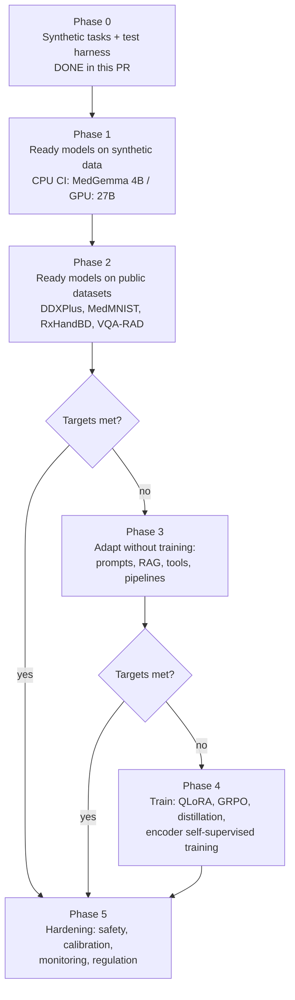
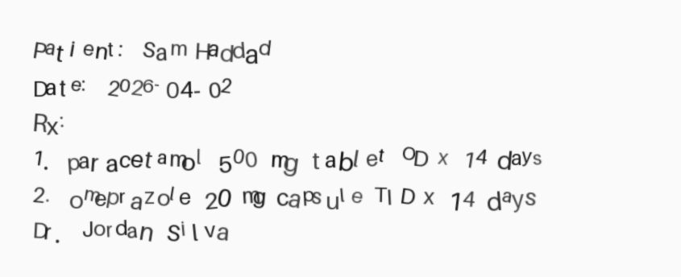
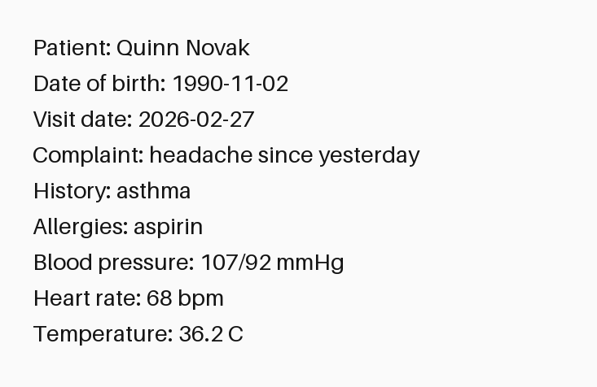
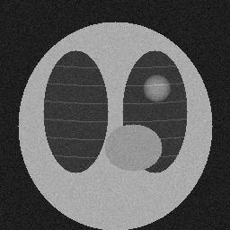
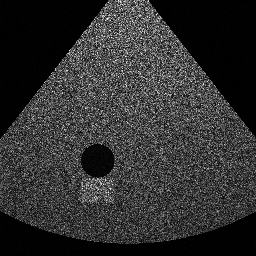

# Research plan: teaching a neural network to process medical data

This is the step-by-step plan that issue #1 asks for. Each phase lists:

* the goal;
* what to do, with the commands that already work in this repository;
* the resources it needs;
* the other ways to do it, with pros and cons;
* when the phase is done.

## Overview

| Phase | Typical duration | Hardware | Status |
| --- | --- | --- | --- |
| 0. Harness | 1–2 weeks | any laptop | **done** (`src/medbench`, 6 tasks, metrics, calculator) |
| 1. Ready models, synthetic data | 1 week | GitHub CPU runner + one GPU with 24 GB or more | CI workflow ready; CPU job runs on every PR that touches the harness |
| 2. Ready models, public data | 2–4 weeks | one 24–80 GB GPU | planned |
| 3. Adaptation without training | 2–4 weeks | same | planned |
| 4. Training | 1–3 months | 1–8 GPUs with 24–80 GB | planned, only if needed |
| 5. Hardening | ongoing | same | planned |

## Phase 0: a harness that tests any model the same way (done)

**Goal:** before trying any model, be able to give it a task, read its
answer and score it automatically, without real patient data.

What exists now:

| Task (`--task`) | What the model sees | What is scored | Code |
| --- | --- | --- | --- |
| `diagnosis` | A made-up patient: age, sex, symptoms | Ranked list of 5 diagnoses: top-1, top-3, top-5, MRR | `synthetic_cases.py` |
| `ocr-prescription` | A rendered handwritten prescription | Character and word error rate; drug + strength recall | `synthetic_documents.py` |
| `ocr-history` | A rendered printed medical history | Character and word error rate | same |
| `imaging-xray` / `imaging-mri` / `imaging-ultrasound` | A phantom image with or without a bright "finding" | Is there a finding? On which side? Sensitivity, specificity | `synthetic_images.py` |

| Sample input | Picture |
| --- | --- |
| Handwritten prescription |  |
| Printed history |  |
| Chest X-ray phantom (finding on the left) |  |
| Brain MRI phantom |  |
| Ultrasound phantom |  |

The model talks to the harness over the OpenAI-compatible HTTP API. That
means the same test works with llama.cpp, Ollama, vLLM, SGLang or TGI, on
CPU or GPU.

Alternatives for the harness:

| Option | Pros | Cons |
| --- | --- | --- |
| **Own small harness (chosen)** | Runs in seconds without downloads; synthetic truth is exact; fits CI | Synthetic data is easier than real data |
| MedEvalKit / VLMEvalKit / lmms-eval | Standard public benchmarks, comparable with papers | Big downloads, GPU needed, many datasets are non-commercial |
| Only manual testing | No code | Not repeatable, cannot run in CI |

We use our harness for CI, and one of the public kits in Phase 2 to compare
with published numbers.

## Phase 1: ready models on synthetic tasks

**Goal:** see whether the named models can do the tasks at all, and how
fast they are.

Steps:

1. CPU, on every PR that changes the harness: the `cpu-smoke` job in
   [`.github/workflows/model-tests.yml`](../../../.github/workflows/model-tests.yml)
   runs **MedGemma 4B Q4_K_M** on diagnosis, X-ray and prescription OCR,
   2 items each.
2. GPU, started by hand: the `gpu` job runs **MedGemma 27B** (or 4B) on all
   6 tasks, 20 items each, on a self-hosted runner. See
   [ci-and-gpu-runner.md](ci-and-gpu-runner.md).
3. Locally: `bash scripts/medbench-model-run.sh download && bash
   scripts/medbench-model-run.sh run`. It needs at least about 6 GB of free
   RAM. On a machine with less, it falls back to mmap and becomes 10 times
   slower ([measurements.md](measurements.md)).
4. UniMedVL: it has no GGUF build, so run it with PyTorch on a 40 GB+ GPU
   through `TransformersBackend` or a vLLM/SGLang server, and point
   `medbench run --backend openai --base-url ...` at it.

Resources from `medbench estimate` (raw output in
[data/estimates.txt](data/estimates.txt)). 120 requests = 6 tasks × 20 items:

| Model | Where | Memory | Speed | 120 requests (full set) |
| --- | --- | --- | --- | --- |
| MedGemma 4B Q4 | GitHub CPU runner | 3.8 GB | 7.8 tokens/s measured; about 66 s to read each image | about 2 hours |
| MedGemma 4B Q4 | L4 24 GB | 3.8 GB | 65 tokens/s | about 8 minutes |
| MedGemma 27B Q4 | L4 24 GB | 18.3 GB | 10 tokens/s | about 51 minutes |
| MedGemma 27B bf16 | A100 80 GB | 56.3 GB | 22 tokens/s | about 24 minutes |
| UniMedVL bf16 | A100 80 GB | 30.2 GB | 80 tokens/s | about 7 minutes |

Alternatives for running models:

| Option | Pros | Cons |
| --- | --- | --- |
| **llama.cpp `llama-server` (chosen)** | One binary, CPU and GPU, 4-bit GGUF, vision support, pinned by SHA-256 | Only models with GGUF conversions (no UniMedVL) |
| Ollama | Easiest install | Hides versions and files; harder to pin |
| vLLM / SGLang | Fastest on GPU, many users at once | GPU only, large install |
| Hugging Face Transformers | Every model, including UniMedVL | Slow on CPU, needs a large PyTorch install |
| Cloud APIs | No hardware | Not allowed for credentialed data, costs per call, results change over time |

**Done when:** both MedGemma sizes have a JSON report for every task, and
the speed numbers are added to [measurements.md](measurements.md).

**Status:** step 1 has run. MedGemma 4B on a GitHub CPU runner got
diagnosis 2/2, prescription OCR with 1% character errors, and X-ray 0/2
([measurements.md §9](measurements.md#9-a-real-run-on-a-github-hosted-cpu-runner)).
Steps 2 and 4 wait for a GPU runner.

## Phase 2: ready models on public data

**Goal:** check that the results hold on real (public, permissive) data,
not only on our phantoms.

| Task | Dataset (license) | Metric |
| --- | --- | --- |
| Diagnosis | DDXPlus test (CC BY 4.0); MedQA | top-k against the ranked differential |
| Prescriptions | RxHandBD (CC BY 4.0) | CER, drug + strength recall |
| Histories | Synthea records rendered with noise (Apache-2.0); CORD (CC BY 4.0) | CER |
| X-ray | MedMNIST pneumonia/chest (CC BY 4.0); NIH ChestX-ray14 | sensitivity, specificity, AUROC |
| MRI / CT | MSD (CC BY-SA 4.0), IXI | accuracy; Dice for masks |
| Ultrasound | MedMNIST breast, HC18 (CC BY 4.0) | accuracy; mm error |
| VQA | VQA-RAD (CC0), SLAKE | accuracy |

Full list, licenses and traps: [research-notes/datasets.md](research-notes/datasets.md).

Models to compare: MedGemma 4B / 1.5 4B / 27B / 27B-text, Lingshu-7B,
Hulu-Med-7B and UniMedVL. For OCR, compare olmOCR-2, PaddleOCR-VL, Chandra
and Tesseract. For imaging, add TorchXRayVision and nnU-Net as non-LLM
baselines. See [architectures.md](architectures.md) for why each one is on
the list.

**Done when:** one table shows every model on every task with 95%
confidence intervals, and the targets in
[if-models-fail.md](if-models-fail.md#1-first-decide-what-fail-means)
are marked met or not met.

## Phase 3: adapt without training

**Goal:** close the gap cheaply.

* Better prompts: examples in the prompt, ask for a ranked list in a fixed
  format, self-consistency (ask 5 times, vote).
* RAG: look up clinical guidelines and drug databases (RxNorm) and put the
  relevant text into the prompt.
* Pipelines: OCR model → drug-name matcher → dose checker; segmentation
  network → measurement → VLM explanation.
* Ensembles: VLM plus TorchXRayVision as a second opinion.

Pros and cons are in [if-models-fail.md §2](if-models-fail.md#2-the-ladder-cheapest-step-first).

## Phase 4: train (only if Phases 2–3 miss the targets)

Follow the ladder in [if-models-fail.md](if-models-fail.md):

1. QLoRA on MedGemma 4B: 4.9 GB of GPU memory.
2. QLoRA on MedGemma 27B: 19.6 GB.
3. GRPO on checkable answers.
4. Distillation to 4B.
5. Self-supervised training of the encoder for image types it handles
   badly.

Data comes from the collection pipeline in
[if-models-fail.md §4](if-models-fail.md#4-collecting-a-dataset) and the
augmentation rules in §5.

## Phase 5: hardening

* Calibration and "I don't know" answers.
* Red-team tests for dangerous outputs.
* Bias checks by age, sex and scanner.
* Monitoring after deployment.
* Regulatory paperwork if this ever becomes a product (FDA PCCP, EU MDR
  and the AI Act).

## Protecting the development machine

The issue asks us not to overload the development machine. The rules below
were followed while writing this PR and are built into the scripts:

* Heavy runs use `nice -n 10` and fewer threads than CPUs (`THREADS` =
  CPUs − 1).
* Every run has a time budget (`TIME_BUDGET`) and a per-request timeout.
* The memory preflight reads the cgroup limit and avoids copying weights
  that do not fit.
* 27B and UniMedVL are only run on a GPU runner, never locally on CPU.
* When the local 4B vision run was too slow (1.5 tokens/s at the memory
  limit), it was stopped instead of left running for hours.
